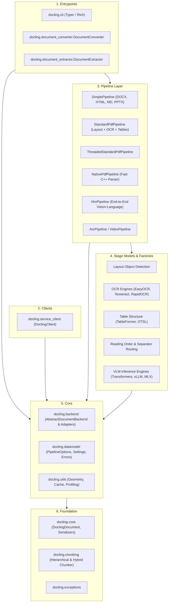
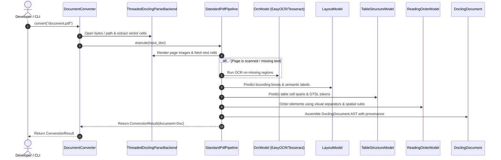

# Architecture

**Analysis Date:** 2026-10-15

## Pattern Overview

**Overall:** Modular Multi-Stage Pipeline Architecture with Pluggable Document Backends and Unified AST Document Representation.

**Key Characteristics:**
- **Decoupled Backend & Pipeline Contracts:** Separate stages for document ingestion (raw file/byte decoding) and semantic document enrichment (AI layout analysis, OCR, table extraction).
- **Unified Document AST:** All formats (PDF, Office, HTML, Markdown, Audio, Images) normalize into a single canonical [`DoclingDocument`](file:///C:/Projects1/Others/docling/docling/datamodel/document.py) representation.
- **Per-Run Isolation & Thread Safety:** The PDF conversion engine maintains worker pools with bounded queues and deterministic run identifiers, preventing cross-turn state pollution.
- **Layer Boundary Enforcement:** Formally enforced using `tach` into 6 acyclic architectural layers.

---

## Architectural Layers (Tach Enforced)

### 1. Entrypoints Layer

- **Purpose:** Public user-facing interfaces and high-level conversion APIs.
- **Components:**
  - [`DocumentConverter`](file:///C:/Projects1/Others/docling/docling/document_converter.py): Main conversion API handling single documents, iterables, and batches.
  - [`DocumentExtractor`](file:///C:/Projects1/Others/docling/docling/document_extractor.py): Targeted key-value and schema extraction interface.
  - [`docling.cli.main`](file:///C:/Projects1/Others/docling/docling/cli/main.py): CLI interface supporting conversions, exports, benchmarking, and remote service triggers.

### 2. Clients Layer

- **Purpose:** Client SDK for remote document conversion.
- **Components:**
  - [`DoclingClient`](file:///C:/Projects1/Others/docling/docling/service_client/client.py) & [`_AsyncDoclingClient`](file:///C:/Projects1/Others/docling/docling/service_client/_async_client.py): Handles HTTP communication with remote Docling Serve microservice clusters.

### 3. Pipeline Layer

- **Purpose:** Orchestrates multi-stage processing of parsed inputs into documents.
- **Pipelines:**
  - [`SimplePipeline`](file:///C:/Projects1/Others/docling/docling/pipeline/simple_pipeline.py): Lightweight pipeline for native structured formats (DOCX, PPTX, XLSX, HTML, Markdown). Reads directly from backend and builds [`DoclingDocument`](file:///C:/Projects1/Others/docling/docling/datamodel/document.py).
  - [`StandardPdfPipeline`](file:///C:/Projects1/Others/docling/docling/pipeline/standard_pdf_pipeline.py): Production multi-stage computer vision pipeline for complex PDFs and images.
  - [`NativePdfPipeline`](file:///C:/Projects1/Others/docling/docling/pipeline/native_pdf_pipeline.py): Ultra-fast model-free conversion relying on `docling-parse` programmatic font and vector text extraction.
  - [`VlmPipeline`](file:///C:/Projects1/Others/docling/docling/pipeline/vlm_pipeline.py): Direct page-to-document conversion using vision-language models (e.g., Granite Vision, Qwen2-VL, MinerU2).
  - [`AsrPipeline`](file:///C:/Projects1/Others/docling/docling/pipeline/asr_pipeline.py) & [`VideoPipeline`](file:///C:/Projects1/Others/docling/docling/pipeline/video_pipeline.py): Transcribes audio streams and samples video frames.

### 4. Stage Models & Factories Layer

- **Purpose:** Individual computer vision and machine learning models for visual understanding.
- **Key Modules:**
  - Layout Object Detection: Predicts bounding boxes and labels for paragraphs, headers, tables, pictures.
  - OCR Engines: Executes text recognition on image regions or scanned pages.
  - Table Structure Extraction: Converts raw table pixels into OTSL tokens and structured grid cells.
  - Reading Order & Separators: Reconstructs two-column and multi-column reading flow using spatial topological sorting and vector rule separators.
  - Picture Description: Generates captions and extracts data from charts and diagrams.

### 5. Core Layer

- **Purpose:** Format backends, option definitions, settings, and spatial utilities.
- **Key Modules:**
  - [`AbstractDocumentBackend`](file:///C:/Projects1/Others/docling/docling/backend/abstract_backend.py): Abstract base class for all file decoders.
  - [`docling.datamodel.pipeline_options`](file:///C:/Projects1/Others/docling/docling/datamodel/pipeline_options.py): Strongly-typed Pydantic configuration schemas.
  - [`docling.datamodel.settings`](file:///C:/Projects1/Others/docling/docling/datamodel/settings.py): Global environment settings.

### 6. Foundation Layer

- **Purpose:** Fundamental data structures, serialization, and error hierarchy.
- **Key Modules:**
  - `docling-core`: Canonical `DoclingDocument` AST, node hierarchy (`TextItem`, `TableItem`, `PictureItem`), and Markdown/HTML/JSON serializers.
  - [`docling.chunking`](file:///C:/Projects1/Others/docling/docling/chunking/__init__.py): Hierarchical and hybrid document chunkers for RAG workflows.
  - [`docling.exceptions`](file:///C:/Projects1/Others/docling/docling/exceptions.py): Unified exception taxonomy.

---

## Data Flow (Standard PDF Conversion Lifecycle)

---

## Key Abstractions

1. **`FormatOption`** ([`docling.document_converter.FormatOption`](file:///C:/Projects1/Others/docling/docling/document_converter.py#L135)):
   - Binds an `InputFormat` to a specific `pipeline_cls`, `backend`, and `pipeline_options`.
2. **`AbstractDocumentBackend`** ([`docling.backend.abstract_backend.AbstractDocumentBackend`](file:///C:/Projects1/Others/docling/docling/backend/abstract_backend.py)):
   - Decouples file loading from processing. Subclasses implement page iteration, text cell extraction, and image rendering.
3. **`BaseModelWithOptions` & `BaseFactory`** ([`docling.models.factories.base_factory.BaseFactory`](file:///C:/Projects1/Others/docling/docling/models/factories/base_factory.py)):
   - Dynamically loads and instantiates model stages using Pluggy plugin hooks and entry points without hardcoded imports.
4. **`DocChunk` & `BaseChunker`** ([`docling.chunking`](file:///C:/Projects1/Others/docling/docling/chunking/__init__.py)):
   - Preserves section hierarchies, metadata, and table boundaries when partitioning documents into token-bounded chunks for LLM vector embeddings.

---

## Error Handling Strategy

- All custom exceptions inherit from [`DoclingError`](file:///C:/Projects1/Others/docling/docling/exceptions.py) -> [`ConversionError`](file:///C:/Projects1/Others/docling/docling/exceptions.py).
- Failed documents return a [`ConversionResult`](file:///C:/Projects1/Others/docling/docling/datamodel/document.py) with `status = ConversionStatus.FAILURE` and a list of structured [`ErrorItem`](file:///C:/Projects1/Others/docling/docling/datamodel/base_models.py) objects categorizing the failure (`FailureCategory.CORRUPTED_FILE`, `FailureCategory.ENCRYPTION`, `FailureCategory.TIMEOUT`).
- Batch conversions continue across individual document failures unless `raises_on_error=True`.

---
*Architecture analysis: 2026-10-15*
