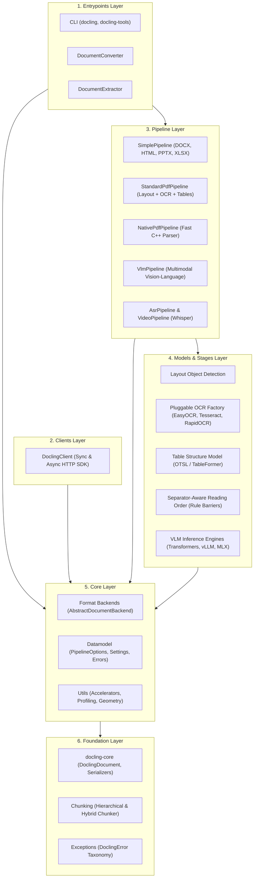

# Docling Codebase Architecture & Feature Replication Blueprint

> [!NOTE]
> This document maps the architecture, design rationale, and feature catalog of **Docling** ([docling](file:///C:/Projects1/Others/docling)). It enables engineers and autonomous AI agents to understand the system end-to-end and replicate its architectural patterns in downstream projects.

---

## 1. Executive Summary & Core Value

**Docling** is an open-source Python SDK and CLI that converts heterogeneous document formats (PDFs, Microsoft Office, HTML, Markdown, XML, Audio, and Video) into a unified, high-fidelity, structure-preserving data representation called [`DoclingDocument`](file:///C:/Projects1/Others/docling/docling/datamodel/document.py).

### Core Problem Solved
1. **Format Fragmentation:** Ingesting 35+ file types into LLMs typically requires custom parsers for each format. Docling standardizes everything into one AST.
2. **Loss of Structure in RAG:** Raw text extraction strips headings, reading order, and table alignments. Docling preserves exact bounding box provenance, heading hierarchies, and complex table topologies (OTSL).
3. **Deep Learning Overhead:** Forcing neural networks on clean digital PDFs or simple Word files wastes massive compute. Docling employs a **dual-path hybrid architecture** that runs fast programmatic extraction when possible and falls back to computer vision only when necessary.

---

## 2. Enforced Architectural Layers (Tach)

The architecture is formally validated by `tach` into 6 strictly acyclic layers:



---

## 3. The 7 GSD Codebase Mapping Artifacts

The codebase has been analyzed and recorded into `.planning/codebase/`:

1. [**STACK.md**](file:///C:/Projects1/Others/docling/.planning/codebase/STACK.md): Python 3.10-3.14, C++ bindings (`docling-parse`), Pydantic v2, Typer, Rich, PyTorch, Transformers, vLLM, MLX, and UV package manager.
2. [**INTEGRATIONS.md**](file:///C:/Projects1/Others/docling/.planning/codebase/INTEGRATIONS.md): OCR engines (EasyOCR, Tesseract, RapidOCR, Mac Vision, Nemotron, KServe v2), Hugging Face models (Granite Vision, SmolVLM, Qwen2-VL, MinerU2), and remote Docling Serve client.
3. [**ARCHITECTURE.md**](file:///C:/Projects1/Others/docling/.planning/codebase/ARCHITECTURE.md): Multi-stage pipeline architecture, bounded thread pools with backpressure, and data lifecycle sequences.
4. [**STRUCTURE.md**](file:///C:/Projects1/Others/docling/.planning/codebase/STRUCTURE.md): Physical repository layout, entry points, and monorepo workspace structure.
5. [**CONVENTIONS.md**](file:///C:/Projects1/Others/docling/.planning/codebase/CONVENTIONS.md): ASD-STE100 technical English, Python 3.10+ typing, Pydantic schemas, pathlib standards, and linter gates.
6. [**TESTING.md**](file:///C:/Projects1/Others/docling/.planning/codebase/TESTING.md): Pytest suites (unit, e2e, regression), golden reference test data protocols (`DOCLING_GEN_TEST_DATA=1`), and CI targets.
7. [**CONCERNS.md**](file:///C:/Projects1/Others/docling/.planning/codebase/CONCERNS.md): Technical risks, memory consumption with heavy models, GIL contention, and AST backwards compatibility.

---

## 4. Reusable Feature Blueprints Catalog

For future agents and developers building similar systems, detailed blueprints are available in `.planning/features/`:

```
.planning/features/
├── FEATURE_CATALOG.md                     # Master index & cross-project feature matrix
├── 01_UNIFIED_DOCUMENT_MODEL.md           # Canonical multimodal AST & spatial provenance
├── 02_MULTI_FORMAT_PARSER_PIPELINE.md     # Universal format dispatching & pipeline caching
├── 03_HYBRID_PDF_AND_OCR_PIPELINE.md      # Dual-path PDF parsing & separator-aware reading order
├── 04_TABLE_STRUCTURE_EXTRACTION.md       # TableFormer & OTSL table grid recovery
├── 05_VLM_AND_MULTIMODAL_ENRICHMENT.md    # Multi-engine VLM adapter (Transformers, vLLM, MLX)
├── 06_RAG_AWARE_CHUNKING.md               # Structure-preserving hierarchical & hybrid chunkers
├── 07_MODULAR_SLIM_PACKAGING.md           # Zero-copy monorepo packaging (docling-slim vs full)
└── 08_REMOTE_SERVICE_CLIENT.md            # Asynchronous job-based client SDK with backoff polling
```

---

## 5. Quick Comparison: Which Pipeline to Use?

| Pipeline | Best Suited For | Speed | Memory Footprint | OCR / Vision Required? |
| :--- | :--- | :--- | :--- | :--- |
| [`NativePdfPipeline`](file:///C:/Projects1/Others/docling/docling/pipeline/native_pdf_pipeline.py) | Clean digital PDFs with embedded vector text | **Ultra Fast** (10-50x) | **Minimal** (~50MB) | No |
| [`StandardPdfPipeline`](file:///C:/Projects1/Others/docling/docling/pipeline/standard_pdf_pipeline.py) | Complex scientific/financial PDFs, scanned pages | Standard (1-5s/page) | High (1-4GB VRAM) | Yes (Layout + OCR + Tables) |
| [`SimplePipeline`](file:///C:/Projects1/Others/docling/docling/pipeline/simple_pipeline.py) | Word (.docx), PowerPoint (.pptx), HTML, Markdown | **Fast** (<500ms) | **Minimal** (~50MB) | No |
| [`VlmPipeline`](file:///C:/Projects1/Others/docling/docling/pipeline/vlm_pipeline.py) | End-to-end vision-language parsing (MinerU2, Qwen2) | Heavy (GPU dependent)| High (4-16GB VRAM) | End-to-end VLM |
| [`AsrPipeline`](file:///C:/Projects1/Others/docling/docling/pipeline/asr_pipeline.py) | Audio & video recording transcriptions (Whisper) | Realtime/Near-realtime| Medium (500MB-2GB) | Audio Speech Recognition |

---
*Saved to .planning: 2026-10-15*
