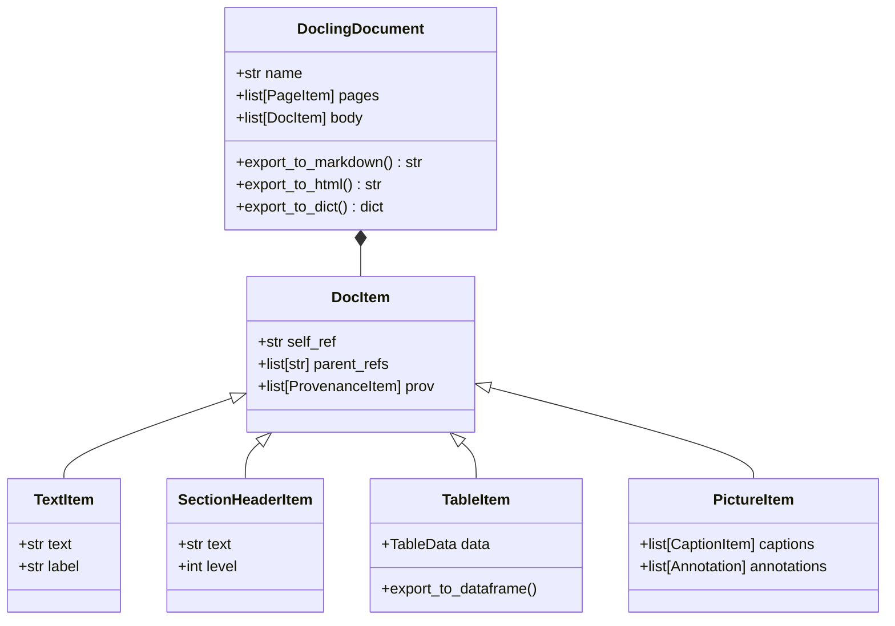

# Feature Blueprint 01: Unified Multimodal Document AST & Provenance

**Feature ID:** `FEAT-01`
**Module Scope:** `docling-core` & [`docling/datamodel/document.py`](file:///C:/Projects1/Others/docling/docling/datamodel/document.py)

---

## 1. Problem Statement & Business Rationale

### The Problem
In enterprise document processing, inputs arrive in disparate formats: PDFs (vector glyphs and raster scans), Word (.docx), PowerPoint (.pptx), Excel (.xlsx), HTML, and XML. Each format has distinct internal hierarchies. Without a shared canonical representation:
- Every exporter (Markdown, HTML, JSON, LaTeX) must write specialized conversion logic for each format (an $O(N \times M)$ engineering burden).
- Downstream GenAI features (RAG chunking, vector indexing, visual grounding) lose consistent access to bounding boxes, heading levels, and reading order.

### The Solution
Docling implements a single, strongly-typed Abstract Syntax Tree (AST) called `DoclingDocument`. All format backends parse raw inputs into this intermediate representation. All downstream consumers (serializers, chunkers, visualizers) operate exclusively on `DoclingDocument`.

---

## 2. Architecture & Component Map



### Key Classes
- **`DoclingDocument`**: Root container maintaining the document tree, page dimensions, metadata, and references.
- **`DocItem`**: Abstract base node for all document content elements. Contains unique pointer IDs (`self_ref`), parent references, and spatial provenance.
- **`SectionHeaderItem`**: Represents headings with an explicit integer hierarchy `level` (1 for H1, 2 for H2, etc.).
- **`TableItem`**: Carries rich tabular data including cell bounding boxes, column/row spans, and OTSL structure representations.
- **`PictureItem`**: Encapsulates images, figures, charts, associated captions, and VLM-generated descriptions.
- **`ProvenanceItem`**: Encapsulates spatial coordinates (`BoundingBox`), page index (`page_no`), and coordinate origin reference (`TOP_LEFT` vs `BOTTOM_LEFT`).

---

## 3. Data Flow

1. **Ingestion**: A backend decoder reads bytes or file paths and initializes an empty `DoclingDocument`.
2. **Node Creation**: As paragraphs, headers, and tables are recognized, `DocItem` nodes are instantiated and appended to the document body.
3. **Hierarchy Assembly**: Parent-child links are established (e.g. section headers parent their child paragraphs).
4. **Provenance Attachment**: Bounding boxes extracted from PDF text cells or OCR are attached to the node's `prov` list.
5. **Universal Export**: The user calls `doc.export_to_markdown()`, which traverses the node tree in reading order and formats headers, tables, and text uniformly.

---

## 4. Cross-Project Connection

- **Backend Layer**: All classes in [`docling/backend/`](file:///C:/Projects1/Others/docling/docling/backend/) construct or contribute items to `DoclingDocument`.
- **Pipeline Layer**: Pipelines ([`StandardPdfPipeline`](file:///C:/Projects1/Others/docling/docling/pipeline/standard_pdf_pipeline.py), [`SimplePipeline`](file:///C:/Projects1/Others/docling/docling/pipeline/simple_pipeline.py)) produce a [`ConversionResult`](file:///C:/Projects1/Others/docling/docling/datamodel/document.py) that wraps `document: DoclingDocument`.
- **Chunking Layer**: [`HierarchicalChunker`](file:///C:/Projects1/Others/docling/docling/chunking/__init__.py) uses parent references and `SectionHeaderItem` nodes to construct context-aware chunks.

---

## 5. Replication Guide (How to Build in Another Project)

To build a unified document AST in your own project:

```python
from dataclasses import dataclass, field
from enum import Enum
from typing import Optional

class CoordOrigin(str, Enum):
    TOP_LEFT = "TOP_LEFT"
    BOTTOM_LEFT = "BOTTOM_LEFT"

@dataclass
class BoundingBox:
    l: float  # left
    t: float  # top
    r: float  # right
    b: float  # bottom
    coord_origin: CoordOrigin = CoordOrigin.TOP_LEFT

@dataclass
class Provenance:
    page_no: int
    bbox: BoundingBox

@dataclass
class Node:
    id: str
    parent_id: Optional[str] = None
    prov: list[Provenance] = field(default_factory=list)

@dataclass
class TextNode(Node):
    text: str = ""
    label: str = "paragraph"

@dataclass
class HeaderNode(Node):
    text: str = ""
    level: int = 1

@dataclass
class DocumentTree:
    nodes: list[Node] = field(default_factory=list)

    def to_markdown(self) -> str:
        lines = []
        for node in self.nodes:
            if isinstance(node, HeaderNode):
                lines.append(f"{'#' * node.level} {node.text}\n")
            elif isinstance(node, TextNode):
                lines.append(f"{node.text}\n")
        return "\n".join(lines)
```

### Pitfalls to Avoid:
1. **Coordinate Origin Inconsistency**: PDFs usually use bottom-left origins; image rasters and web browsers use top-left. Explicitly tag every bounding box with its coordinate system and normalize upon ingestion.
2. **Direct Tree Nesting vs Flat Reference Trees**: Deeply nested trees become hard to serialize and manipulate. A flat list of nodes where each node has a unique `id` and `parent_id` is vastly easier to filter, search, and serialize.
