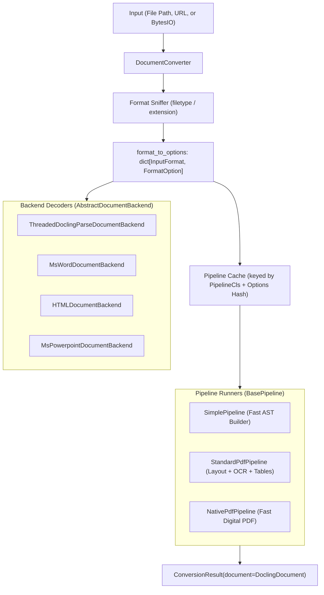

# Feature Blueprint 02: Multi-Format Ingestion & Extensible Pipeline Dispatch

**Feature ID:** `FEAT-02`
**Module Scope:** [`docling/document_converter.py`](file:///C:/Projects1/Others/docling/docling/document_converter.py), [`docling/backend/`](file:///C:/Projects1/Others/docling/docling/backend/), [`docling/pipeline/`](file:///C:/Projects1/Others/docling/docling/pipeline/)

---

## 1. Problem Statement & Business Rationale

### The Problem
Real-world enterprise repositories mix PDFs, Word files, PowerPoint decks, spreadsheets, scanned images, and HTML web pages. If developers must write different code for each document type, their application code becomes fragile, tightly coupled, and difficult to maintain.

### The Solution
Docling provides a unified facade pattern through [`DocumentConverter`](file:///C:/Projects1/Others/docling/docling/document_converter.py). A single call to `converter.convert("source")` automatically detects the document format, selects the appropriate backend reader, executes the corresponding pipeline, and returns a uniform `ConversionResult`.

---

## 2. Architecture & Component Map



### Key Components
- **[`DocumentConverter`](file:///C:/Projects1/Others/docling/docling/document_converter.py)**: The central orchestrator. Maintains `allowed_formats`, configuration options, and the pipeline cache.
- **[`FormatOption`](file:///C:/Projects1/Others/docling/docling/document_converter.py#L135)**: Binds an `InputFormat` to a specific backend reader, pipeline runner class, and pipeline options.
- **[`AbstractDocumentBackend`](file:///C:/Projects1/Others/docling/docling/backend/abstract_backend.py)**: Strategy interface for raw document ingestion. Subclasses open inputs and extract native text tokens and page dimensions.
- **Pipeline Cache (`_PIPELINE_CACHE_LOCK`)**: Heavy pipelines (loading deep learning weights) are compiled once and shared across requests with identical options.

---

## 3. Data Flow

1. **Input Normalization**: `DocumentConverter.convert()` receives a file path, URL, or stream. If a URL is passed, it downloads the content to a temporary buffer.
2. **Format Detection**: Inspects magic bytes via `filetype` and falls back to file extensions to resolve the `InputFormat` enum.
3. **Option Lookup**: Retrieves the configured `FormatOption` for that format from `self.format_to_options`.
4. **Pipeline Retrieval**: Generates a deterministic hash of `(FormatOption.pipeline_cls, pipeline_options)` and checks the in-memory cache. If missing, it instantiates the pipeline under a thread lock.
5. **Execution**: The pipeline loads the backend, iterates over pages, enriches elements, and outputs a `ConversionResult`.

---

## 4. Cross-Project Connection

- **Configuration Layer**: `FormatOption` accepts custom `PipelineOptions` from [`docling/datamodel/pipeline_options.py`](file:///C:/Projects1/Others/docling/docling/datamodel/pipeline_options.py).
- **Backend Layer**: Backends implement the same contract ([`AbstractDocumentBackend`](file:///C:/Projects1/Others/docling/docling/backend/abstract_backend.py)) regardless of whether they wrap a C++ binary (`docling-parse`) or a Python library (`python-docx`).
- **CLI**: The command-line interface (`docling convert`) directly instantiates `DocumentConverter` with flags translated into `FormatOption` overrides.

---

## 5. Replication Guide (How to Build in Another Project)

To implement a multi-format pipeline registry in another project:

```python
from enum import Enum
from typing import Type, Any
from pathlib import Path
import threading

class Format(str, Enum):
    PDF = "pdf"
    DOCX = "docx"
    HTML = "html"

class BaseBackend:
    def parse(self, path: Path) -> dict:
        raise NotImplementedError

class BasePipeline:
    def run(self, backend: BaseBackend, path: Path) -> str:
        raise NotImplementedError

class FormatOption:
    def __init__(self, backend_cls: Type[BaseBackend], pipeline_cls: Type[BasePipeline]):
        self.backend_cls = backend_cls
        self.pipeline_cls = pipeline_cls

class UniversalConverter:
    def __init__(self):
        self._lock = threading.Lock()
        self._pipeline_cache: dict[Type[BasePipeline], BasePipeline] = {}
        self.registry: dict[Format, FormatOption] = {}

    def register_format(self, fmt: Format, option: FormatOption):
        self.registry[fmt] = option

    def convert(self, file_path: Path) -> str:
        ext = file_path.suffix.lstrip(".").lower()
        fmt = Format(ext)
        option = self.registry[fmt]

        # Thread-safe pipeline caching
        with self._lock:
            if option.pipeline_cls not in self._pipeline_cache:
                self._pipeline_cache[option.pipeline_cls] = option.pipeline_cls()
            pipeline = self._pipeline_cache[option.pipeline_cls]

        backend = option.backend_cls()
        return pipeline.run(backend, file_path)
```

### Pitfalls to Avoid:
1. **Re-initializing Heavy ML Models on Every Document**: Loading PyTorch or layout models inside each `convert()` call destroys performance. Cache pipelines keyed by their configuration hash.
2. **Missing Thread Locks on Pipeline Cache**: In multi-threaded environments, multiple workers might initialize duplicate models simultaneously if the cache lookup is not synchronized.
