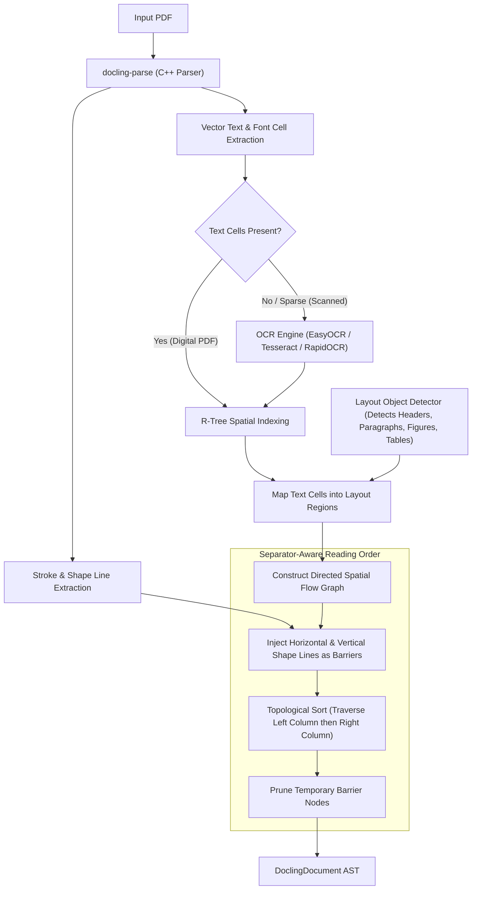

# Feature Blueprint 03: Dual-Path Hybrid PDF & Separator-Aware Reading Order

**Feature ID:** `FEAT-03`
**Module Scope:** [`docling/pipeline/standard_pdf_pipeline.py`](file:///C:/Projects1/Others/docling/docling/pipeline/standard_pdf_pipeline.py), [`native_pdf_pipeline.py`](file:///C:/Projects1/Others/docling/docling/pipeline/native_pdf_pipeline.py), [`reading_order_rb.py`](file:///C:/Projects1/Others/docling/docling/models/postprocessing/reading_order_rb.py)

---

## 1. Problem Statement & Business Rationale

### The Problem
PDF is the most prevalent yet notoriously complex document format:
1. **The Digital vs. Scanned Dilemma:** Running deep neural networks and OCR on digital PDFs (which already contain crisp vector text) wastes 90% of compute time and introduces character recognition typos. Conversely, ignoring OCR fails completely on scanned paper documents.
2. **The Multi-Column Reading Order Trap:** In two-column research papers or newspapers, naive top-to-bottom or left-to-right extraction causes text from Column 1 and Column 2 to interleave sentence-by-sentence, rendering downstream LLM generation unintelligible.

### The Solution
Docling implements a **dual-path hybrid architecture**:
- **Digital Path:** Rapid programmatic extraction via C++ `docling-parse`.
- **Visual Fallback:** Deep learning layout detection and pluggable OCR only where text is missing.
- **Separator-Aware Reading Order:** Visual vector rules (strokes and filled line paths) are extracted and inserted into the reading graph as temporary barrier nodes, enforcing strict column containment before final document assembly.

---

## 2. Architecture & Stage Pipeline



---

## 3. Key Algorithms & Implementation Details

### 1. Vector Shape Line Extraction
- Implemented in `PdfPageBackend.get_shape_lines()`.
- Extracts visible horizontal and vertical line segments directly from PDF vector draw operations.
- Refined to capture thin filled rectangles (e.g. Elsevier journal dividers) in addition to stroked lines.

### 2. Spatial Mapping via R-Tree
- Uses `rtree` spatial indexing to quickly map thousands of word/character bounding boxes into higher-level layout containers (e.g., matching text cells to a detected `SectionHeaderItem` box).

### 3. Barrier-Constrained Topological Sorting
- Reading order is computed as a Directed Acyclic Graph (DAG) where nodes represent detected layout regions.
- Edge weights represent reading likelihood based on vertical projection, horizontal alignment, and reading direction.
- Horizontal rules act as barrier nodes that block edge formation across vertical sections. Vertical rules prevent horizontal expansion into neighboring columns.
- All barrier nodes are removed prior to document serialization so no artificial graphics enter the final text.

---

## 4. Cross-Project Connection

- **Backend Layer:** [`ThreadedDoclingParseDocumentBackend`](file:///C:/Projects1/Others/docling/docling/backend/docling_parse_backend.py) delivers both text cell bounding boxes and shape lines.
- **Factory Layer:** [`OcrFactory`](file:///C:/Projects1/Others/docling/docling/models/factories/ocr_factory.py) initializes the OCR engine if scanned pages are encountered.
- **Pipeline Options:** Configured via `ThreadedPdfPipelineOptions.use_reading_order_separators` and `do_ocr`.

---

## 5. Replication Guide (How to Build in Another Project)

To build a separator-aware multi-column reading order sorter:

```python
from dataclasses import dataclass

@dataclass
class Box:
    id: str
    x0: float
    y0: float
    x1: float
    y1: float
    text: str

@dataclass
class LineSeparator:
    x0: float
    y0: float
    x1: float
    y1: float
    is_vertical: bool

def sort_two_columns(boxes: list[Box], vertical_divider: LineSeparator | None) -> list[Box]:
    if not vertical_divider:
        # Fallback to standard top-to-bottom sort
        return sorted(boxes, key=lambda b: (b.y0, b.x0))

    col_x = vertical_divider.x0
    col_left = []
    col_right = []

    for box in boxes:
        # Assign to left or right column relative to visual separator
        if box.x1 <= col_x:
            col_left.append(box)
        elif box.x0 >= col_x:
            col_right.append(box)
        else:
            # Box spans across divider (e.g. title) -> place at the beginning
            col_left.append(box)

    # Sort each column vertically
    sorted_left = sorted(col_left, key=lambda b: b.y0)
    sorted_right = sorted(col_right, key=lambda b: b.y0)

    # Sequence: Left column first, then right column
    return sorted_left + sorted_right
```

### Pitfalls to Avoid:
1. **Unfiltered Rule Candidates**: Vector drawings in PDFs often include thousands of microscopic lines (e.g., shading, underline embellishments, or chart axes). Filter candidate lines by length (>20pt) and ensure they do not intersect inside an already identified table or image.
2. **Forced Full-Page OCR**: Never run full-page OCR on a page that already has valid programmatic text unless the user explicitly configures `force_full_page_ocr=True`. Running OCR on top of native vector text causes duplicate or overlapping words.
