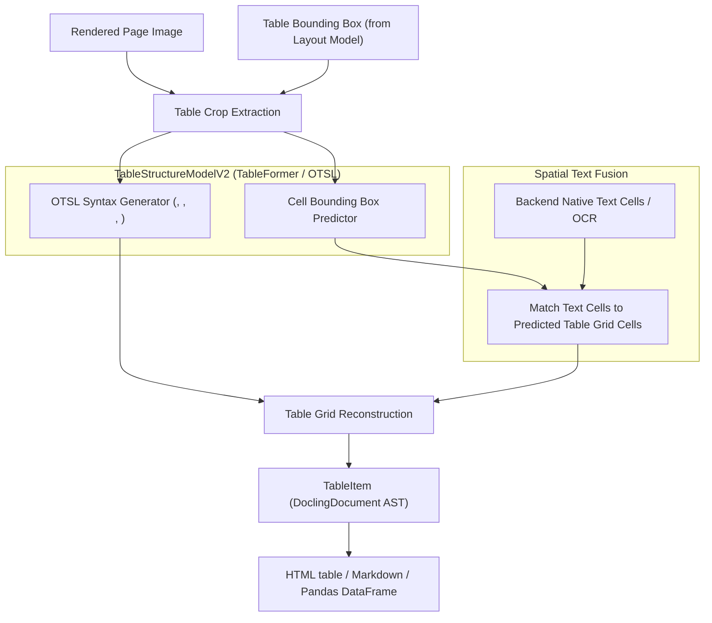

# Feature Blueprint 04: Table Structure Recovery & Open Table Structure Language (OTSL)

**Feature ID:** `FEAT-04`
**Module Scope:** [`docling/models/stages/table_structure/`](file:///C:/Projects1/Others/docling/docling/models/stages/table_structure/), [`docling/utils/otsl.py`](file:///C:/Projects1/Others/docling/docling/utils/otsl.py)

---

## 1. Problem Statement & Business Rationale

### The Problem
Tables are information-dense structures. In PDF documents, tables have no structural metadata: there are no `<table>`, `<tr>`, or `<td>` tags—only loose text coordinates and lines on a canvas.
When standard parsers dump table text into plain strings, spatial alignment is obliterated. An LLM querying an earnings report cannot tell which number belongs to "Q3 2024" versus "Q3 2025," leading to severe business hallucinations.

### The Solution
Docling implements deep-learning-based table structure recognition via **TableFormer / TableStructureModelV2** and the **Open Table Structure Language (OTSL)**:
1. Recovers exact table grid geometry, column spans, and row spans.
2. Formats tables into semantic HTML or Markdown tables that preserve relational data for LLMs.

---

## 2. Architecture & Pipeline Sequence



---

## 3. Key Concepts: OTSL & Table Grid Fusion

### What is OTSL (Open Table Structure Language)?
OTSL is a compact token vocabulary designed specifically to describe complex table topologies:
- `<ched>`: Column header cell
- `<rhed>`: Row header cell
- `<c>`: Regular data cell
- `<empty>`: Empty cell
- `<fcel>`: Fill cell for column spans
- `<lcel>`: Fill cell for row spans

### Grid Fusion Algorithm
1. The model predicts the sequence of OTSL tokens representing the table row-by-row.
2. The bounding box head predicts normalized coordinates for each individual cell.
3. The fusion step maps PDF text glyphs located inside each predicted cell box into the corresponding grid position.
4. When cells span multiple columns or rows, text is aggregated into the primary cell and span properties are set on the resulting table data structure.

---

## 4. Cross-Project Connection

- **Layout Model**: Supplies the initial table bounding box to avoid processing non-tabular page regions.
- **Backend / OCR**: Supplies the text cells that fill each detected table cell.
- **Docling Core**: Converts the table structure into a `TableItem` that provides instant export methods:
  - `table.export_to_dataframe()`
  - `table.export_to_markdown()`
  - `table.export_to_html()`

---

## 5. Replication Guide (How to Build in Another Project)

To represent and render recovered table grids in another project:

```python
from dataclasses import dataclass, field

@dataclass
class TableCell:
    row: int
    col: int
    row_span: int = 1
    col_span: int = 1
    text: str = ""

@dataclass
class TableGrid:
    num_rows: int
    num_cols: int
    cells: list[TableCell] = field(default_factory=list)

    def to_html(self) -> str:
        grid: list[list[TableCell | None]] = [[None for _ in range(self.num_cols)] for _ in range(self.num_rows)]
        for cell in self.cells:
            grid[cell.row][cell.col] = cell

        html = ["<table>"]
        for r in range(self.num_rows):
            html.append("  <tr>")
            for c in range(self.num_cols):
                cell = grid[r][c]
                if cell:
                    attrs = ""
                    if cell.col_span > 1:
                        attrs += f' colspan="{cell.col_span}"'
                    if cell.row_span > 1:
                        attrs += f' rowspan="{cell.row_span}"'
                    html.append(f"    <td{attrs}>{cell.text}</td>")
            html.append("  </tr>")
        html.append("</table>")
        return "\n".join(html)
```

### Pitfalls to Avoid:
1. **Relying Exclusively on OCR Box Coordinates**: OCR models frequently merge adjacent columns when text margins are narrow. Always use a dedicated table model or morphological projection to segment column boundaries before assigning text.
2. **Ignoring Spanning Cells**: Flattening spanned cells into single-column cells corrupts column count alignment in Markdown, rendering tables unreadable by LLMs.
