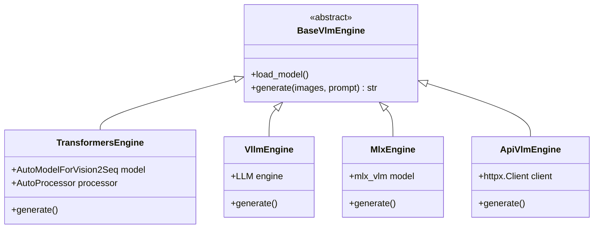
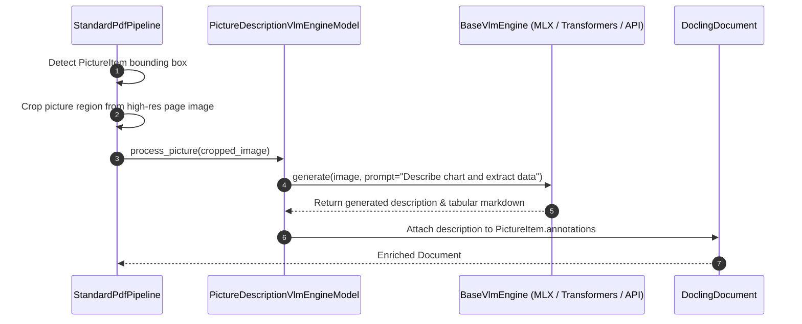

# Feature Blueprint 05: Vision-Language Modeling (VLM) & Multimodal Enrichment

**Feature ID:** `FEAT-05`
**Module Scope:** [`docling/pipeline/vlm_pipeline.py`](file:///C:/Projects1/Others/docling/docling/pipeline/vlm_pipeline.py), [`docling/models/inference_engines/vlm/`](file:///C:/Projects1/Others/docling/docling/models/inference_engines/vlm/), [`docling/models/stages/picture_description/`](file:///C:/Projects1/Others/docling/docling/models/stages/picture_description/)

---

## 1. Problem Statement & Business Rationale

### The Problem
Traditional document conversion tools are blind to non-text visual elements:
- Bar charts, line graphs, architectural blueprints, and flowcharts contain crucial business insights that standard OCR reduces to jumbled, useless letters.
- Running separate disconnected tools for images, charts, and text fragments creates complex integration friction.
- Hardware diversity: Deployments range from Apple Silicon MacBooks (M1/M2/M3/M4) to Linux NVIDIA GPU clusters and serverless CPU endpoints. Forcing a single ML runtime like PyTorch leads to poor performance or installation failures.

### The Solution
Docling provides a **multi-engine Vision-Language Model (VLM) architecture**:
1. Supports visual captioning and chart extraction inside the standard PDF pipeline.
2. Supports full end-to-end visual document parsing via [`VlmPipeline`](file:///C:/Projects1/Others/docling/docling/pipeline/vlm_pipeline.py).
3. Provides pluggable hardware inference engines (Transformers, vLLM, Apple MLX, and HTTP API).

---

## 2. Architecture & Engine Abstraction



### Supported Models
- **Granite Vision** (`ibm-granite/granite-vision-3.1-2b`): Efficient 2B model specialized in document and chart understanding.
- **SmolVLM**: Ultra-lightweight vision-language model for edge/local inference.
- **Qwen2-VL**: High-resolution OCR and visual perception model.
- **MinerU2.5-Pro**: Two-stage full-page document parsing model.

---

## 3. Data Flow: Picture Description Enrichment



---

## 4. Cross-Project Connection

- **Plugin System**: VLM engines are discovered dynamically using [`defaults.py`](file:///C:/Projects1/Others/docling/docling/models/plugins/defaults.py).
- **Accelerators**: Hardware auto-detection in [`docling/utils/accelerator_utils.py`](file:///C:/Projects1/Others/docling/docling/utils/accelerator_utils.py) selects between CUDA, MPS, and CPU.
- **Export Formats**: When exporting to Markdown (`doc.export_to_markdown()`), picture descriptions are inserted as accessible alt-text or markdown comments.

---

## 5. Replication Guide (How to Build in Another Project)

To build a multi-backend VLM adapter:

```python
from abc import ABC, abstractmethod
from PIL import Image

class VlmEngine(ABC):
    @abstractmethod
    def describe_image(self, image: Image.Image, prompt: str) -> str:
        pass

class MockApiVlmEngine(VlmEngine):
    def __init__(self, api_key: str):
        self.api_key = api_key

    def describe_image(self, image: Image.Image, prompt: str) -> str:
        # Send base64 payload to multimodal endpoint
        return "Chart showing 25% revenue growth in Q3 2024."

class VlmEnricher:
    def __init__(self, engine: VlmEngine):
        self.engine = engine

    def enrich_document_images(self, document_images: list[Image.Image]) -> list[str]:
        descriptions = []
        for img in document_images:
            desc = self.engine.describe_image(img, "Extract all data points and describe this figure.")
            descriptions.append(desc)
        return descriptions
```

### Pitfalls to Avoid:
1. **Unbounded Image Resolution**: Passing 4K or 8K page crops directly to a VLM saturates context window tokens and memory. Downscale crops to optimal model dimensions (e.g., 512x512 or 1024x1024) before tokenization.
2. **Coupling to Specific ML Frameworks**: Never hardcode direct `torch` or `transformers` imports in your core business logic. Abstract behind an engine interface so you can switch to vLLM or remote APIs without refactoring.
