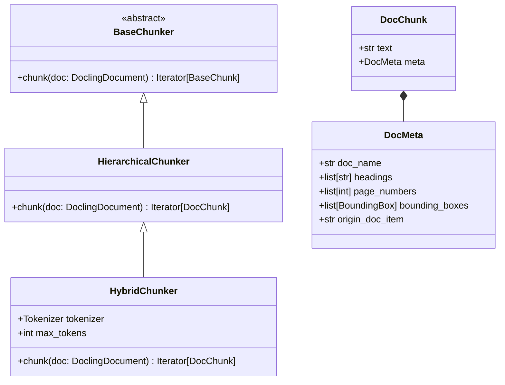
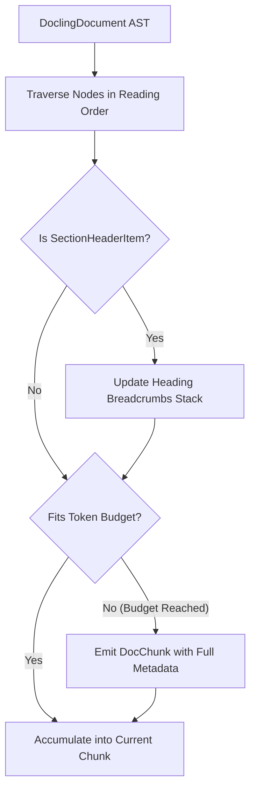

# Feature Blueprint 06: Structure-Preserving RAG Chunking

**Feature ID:** `FEAT-06`
**Module Scope:** [`docling/chunking/__init__.py`](file:///C:/Projects1/Others/docling/docling/chunking/__init__.py) & `docling-core.transforms.chunker`

---

## 1. Problem Statement & Business Rationale

### The Problem
In Retrieval-Augmented Generation (RAG) applications, document text must be partitioned into chunks for vector embedding and retrieval.
Conventional chunking approaches (e.g., fixed-window 500-character splitters):
1. **Lose Critical Context:** A paragraph stating *"The penalty is $100,000"* loses all meaning if separated from its parent heading *"Section 8: Failure to Deliver"*.
2. **Sever Table Grids:** Splitting a table in half across two chunks corrupts financial column headers and row relationships.
3. **Destroy Provenance:** Downstream citations cannot link back to the exact page number or bounding box on the original document.

### The Solution
Docling provides **structure-preserving document chunkers**:
- [`HierarchicalChunker`](file:///C:/Projects1/Others/docling/docling/chunking/__init__.py): Chunks respect section headings, lists, and document hierarchies.
- [`HybridChunker`](file:///C:/Projects1/Others/docling/docling/chunking/__init__.py): Blends structural AST traversal with tokenizer-aware token counting, guaranteeing chunks fit exact LLM embedding model token budgets without severing semantic units.

---

## 2. Architecture & Component Map



### Key Components
- **`DocChunk`**: The self-contained unit returned to vector databases. Contains both the readable text string and structured metadata.
- **`DocMeta`**: Preserves full contextual grounding:
  - `headings`: Breadcrumb stack of all parent headings (e.g., `["Chapter 3", "Security Architecture", "Authentication"]`).
  - `page_numbers`: Exact page(s) where this chunk originated.
  - `bounding_boxes`: Visual coordinates on the original PDF/scan for UI highlight overlays.

---

## 3. Chunking Algorithm



---

## 4. Cross-Project Connection

- **Docling Core AST**: The chunker directly traverses the node hierarchy of `DoclingDocument`.
- **RAG Frameworks**: Output chunks integrate directly with LangChain, LlamaIndex, Haystack, and native vector stores (Milvus, Qdrant, Chroma, Pinecone).

---

## 5. Replication Guide (How to Build in Another Project)

To build a structure-aware hierarchical chunker in another project:

```python
from dataclasses import dataclass, field

@dataclass
class DocumentNode:
    text: str
    is_header: bool = False
    header_level: int = 1
    page_no: int = 1

@dataclass
class ContextualChunk:
    text: str
    headings: list[str]
    page_numbers: list[int]

class SimpleHierarchicalChunker:
    def __init__(self, max_chars: int = 1000):
        self.max_chars = max_chars

    def chunk(self, nodes: list[DocumentNode]) -> list[ContextualChunk]:
        chunks = []
        heading_stack: list[str] = []
        current_text = []
        current_pages = set()
        current_len = 0

        for node in nodes:
            if node.is_header:
                # Adjust breadcrumbs stack based on level
                heading_stack = heading_stack[:node.header_level - 1]
                heading_stack.append(node.text)

            node_len = len(node.text)
            if current_len + node_len > self.max_chars and current_text:
                # Flush existing chunk
                chunks.append(ContextualChunk(
                    text="\n".join(current_text),
                    headings=list(heading_stack),
                    page_numbers=sorted(list(current_pages))
                ))
                current_text = []
                current_pages = set()
                current_len = 0

            current_text.append(node.text)
            current_pages.add(node.page_no)
            current_len += node_len

        if current_text:
            chunks.append(ContextualChunk(
                text="\n".join(current_text),
                headings=list(heading_stack),
                page_numbers=sorted(list(current_pages))
            ))

        return chunks
```

### Pitfalls to Avoid:
1. **Omitting Heading Breadcrumbs**: When embedding chunks into a vector store, prepend the breadcrumb path (e.g. `"Heading: Sales > North America\nText: ..."`) to the chunk text before embedding. This dramatically boosts semantic search accuracy.
2. **Splitting Table Rows**: Treat tables as indivisible atomic units. If a table exceeds the chunk token limit, serialize it row-by-row while repeating the table header row on each subsequent chunk.
