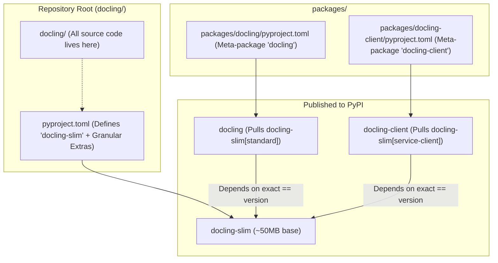

# Feature Blueprint 07: Modular Slim Packaging & Zero-Copy Workspace

**Feature ID:** `FEAT-07`
**Module Scope:** Root [`pyproject.toml`](file:///C:/Projects1/Others/docling/pyproject.toml) & [`packages/`](file:///C:/Projects1/Others/docling/packages/)

---

## 1. Problem Statement & Business Rationale

### The Problem
Machine learning libraries often become victims of their own success:
- Bundling PyTorch, torchvision, transformers, and CUDA binaries creates a multi-gigabyte package.
- Users deploying to serverless environments (e.g. AWS Lambda with a 250MB uncompressed limit) or containerized microservices cannot tolerate gigabytes of unused neural network weights if they only need to parse Word files or call a remote API.
- Yet, splitting the codebase into separate git repositories causes version desynchronization, PR overhead, and fractured issue tracking.

### The Solution
Docling implements a **zero-copy monorepo workspace pattern**:
1. All Python code lives in a single directory: [`docling/`](file:///C:/Projects1/Others/docling/docling/).
2. Root `pyproject.toml` packages this code as `docling-slim` (~50MB baseline) with fine-grained optional extras.
3. Subdirectories under [`packages/`](file:///C:/Projects1/Others/docling/packages/) publish lightweight meta-packages (`docling` and `docling-client`) that pin to exact versions of `docling-slim`.

---

## 2. Architecture & Monorepo Layout



---

## 3. Dependency Structure & Extras

### Minimal Base (~50MB)
Only 8 core dependencies:
```toml
dependencies = [
  'pydantic>=2.0.0,<3.0.0',
  'docling-core>=2.98.0,<3.0.0',
  'pydantic-settings>=2.3.0,<3.0.0',
  'filetype>=1.2.0,<2.0.0',
  'requests>=2.32.2,<3.0.0',
  'certifi>=2024.7.4',
  'pluggy>=1.0.0,<2.0.0',
  'tqdm>=4.65.0,<5.0.0',
  'langcodes>=3.5.0,<4.0.0',
]
```

### Granular Optional Extras
- `[format-pdf]`: `pypdfium2`, `docling-parse`
- `[format-office]`: `python-docx`, `python-pptx`, `openpyxl`
- `[format-web]`: `beautifulsoup4`, `marko`
- `[cli]`: `typer`, `rich`
- `[models-hf]`: `torch`, `torchvision`, `transformers`, `accelerate`
- `[ocr-tesseract]`: `pytesseract`
- `[ocr-easyocr]`: `easyocr`
- `[ocr-rapidocr]`: `rapidocr-onnxruntime`
- `[standard]`: Pulls in standard PDF, Office, Web, CLI, and OCR extras.

---

## 4. Cross-Project Connection

- **Local Development**: `uv` workspace mode links packages in editable mode locally so editing `docling/` immediately reflects across `docling-slim` and `docling`.
- **CI/CD Pipeline**: GitHub Actions builds and publishes `docling-slim` first, followed by the meta-packages.

---

## 5. Replication Guide (How to Build in Another Project)

To configure a dual meta-package/slim architecture using `uv` and `hatchling`:

```toml
# Root pyproject.toml (Base library: mylib-slim)
[build-system]
requires = ["hatchling"]
build-backend = "hatchling.build"

[project]
name = "mylib-slim"
version = "1.0.0"
dependencies = [
    "pydantic>=2.0.0",
]

[project.optional-dependencies]
ai = ["torch>=2.0.0", "transformers>=4.40.0"]
cli = ["typer>=0.12.0"]
standard = ["mylib-slim[ai,cli]"]

[tool.uv.workspace]
members = ["packages/*"]
```

```toml
# packages/mylib/pyproject.toml (Meta-package: mylib)
[build-system]
requires = ["hatchling"]
build-backend = "hatchling.build"

[project]
name = "mylib"
version = "1.0.0"
dependencies = [
    "mylib-slim[standard]==1.0.0",
]

[tool.uv.sources]
mylib-slim = { workspace = true }
```

### Pitfalls to Avoid:
1. **Accidental Root Imports of Heavy Dependencies**: If `docling/__init__.py` imports `torch` or `transformers`, `import docling` will fail for `docling-slim` users even if they only wanted to use lightweight features. Keep heavy imports deferred inside factory methods or pipeline stage executors.
2. **Version Desynchronization**: Always pin the meta-package dependency to the exact matching version (`==x.y.z`) of the slim package to prevent mismatched runtime capabilities.
