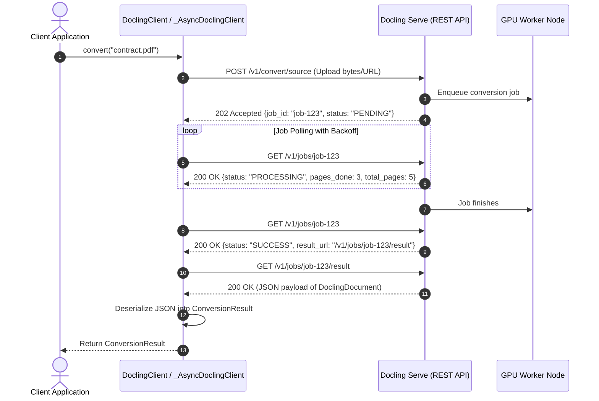

# Feature Blueprint 08: Asynchronous Job-Based Service Client SDK

**Feature ID:** `FEAT-08`
**Module Scope:** [`docling/service_client/`](file:///C:/Projects1/Others/docling/docling/service_client/) & `packages/docling-client/`

---

## 1. Problem Statement & Business Rationale

### The Problem
Processing multi-page PDFs with deep learning models (Layout, TableFormer, OCR) takes anywhere from 2 seconds to 30+ seconds per document.
In client-server architectures:
- Holding open synchronous HTTP requests causes network socket drops and gateway timeouts (e.g. AWS ALB 504 or Nginx 60s timeouts).
- Client applications converting hundreds of files concurrently run out of local sockets and memory if forced to maintain open connections.
- Edge devices (mobile, IoT, serverless lambdas) cannot run heavy ML models locally.

### The Solution
Docling provides a dedicated **remote client SDK** ([`DoclingClient`](file:///C:/Projects1/Others/docling/docling/service_client/client.py)) connecting to Docling Serve:
1. Implements an **asynchronous job submission pattern**: upload payload -> receive `job_id` -> poll or stream progress -> retrieve completed `DoclingDocument`.
2. Provides both synchronous ([`DoclingClient`](file:///C:/Projects1/Others/docling/docling/service_client/client.py)) and asynchronous ([`_AsyncDoclingClient`](file:///C:/Projects1/Others/docling/docling/service_client/_async_client.py)) APIs.
3. Exposes the identical `ConversionResult` interface as local conversions, enabling zero code changes when switching from local execution to cloud serving.

---

## 2. Architecture & Sequence



---

## 3. Key Components

- **[`DoclingClient`](file:///C:/Projects1/Others/docling/docling/service_client/client.py)**: Synchronous facade providing `convert()` and `convert_all()`.
- **[`_AsyncDoclingClient`](file:///C:/Projects1/Others/docling/docling/service_client/_async_client.py)**: High-performance async client using `httpx` or `aiohttp` with connection pooling.
- **[`JobTracker`](file:///C:/Projects1/Others/docling/docling/service_client/job.py)**: Encapsulates state transitions: `PENDING` -> `RUNNING` -> `SUCCESS` / `FAILURE`. Handles exponential backoff and jitter during polling.
- **`ConversionResult` Equivalence**: The JSON returned by the server deserializes into the exact same `DoclingDocument` AST used by local conversions, ensuring that downstream chunking and export code functions identically.

---

## 4. Cross-Project Connection

- **CLI Remote Flag**: Running `docling --remote http://api.docling.ai convert doc.pdf` transparently switches from local execution to [`DoclingClient`](file:///C:/Projects1/Others/docling/docling/service_client/client.py).
- **Lightweight Distribution**: Packaged as `packages/docling-client`, allowing clients to install the SDK without installing PyTorch or docling-parse.

---

## 5. Replication Guide (How to Build in Another Project)

To build a resilient job-polling API client:

```python
import time
import httpx
from typing import Any

class JobStatus:
    PENDING = "PENDING"
    PROCESSING = "PROCESSING"
    SUCCESS = "SUCCESS"
    FAILURE = "FAILURE"

class AsyncJobClient:
    def __init__(self, base_url: str, timeout: float = 300.0):
        self.base_url = base_url.rstrip("/")
        self.timeout = timeout

    async def submit_and_wait(self, file_bytes: bytes, filename: str) -> dict[str, Any]:
        async with httpx.AsyncClient(base_url=self.base_url) as client:
            # 1. Submit Job
            files = {"file": (filename, file_bytes)}
            res = await client.post("/jobs/submit", files=files)
            res.raise_for_status()
            job_id = res.json()["job_id"]

            # 2. Poll with Backoff
            start_time = time.time()
            delay = 0.5

            while time.time() - start_time < self.timeout:
                poll_res = await client.get(f"/jobs/{job_id}")
                poll_res.raise_for_status()
                data = poll_res.json()
                status = data["status"]

                if status == JobStatus.SUCCESS:
                    # 3. Fetch Result
                    result_res = await client.get(f"/jobs/{job_id}/result")
                    result_res.raise_for_status()
                    return result_res.json()
                elif status == JobStatus.FAILURE:
                    raise RuntimeError(f"Job failed on server: {data.get('error')}")

                await asyncio.sleep(delay)
                delay = min(delay * 1.5, 5.0)  # Exponential backoff capped at 5s

            raise TimeoutError(f"Job {job_id} exceeded timeout of {self.timeout}s")
```

### Pitfalls to Avoid:
1. **Aggressive Fixed-Interval Polling**: Polling a server every 50ms overburdens the API gateway. Always use exponential backoff with a minimum delay (e.g. 500ms) or server-sent events (SSE).
2. **Missing In-Flight Cancellation**: When the client aborts or disconnects, send a `DELETE /jobs/{job_id}` request to terminate running GPU tasks on the cluster and free VRAM.
