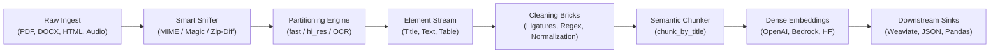

# Unstructured Codebase Map, Architecture & Developer Blueprints

> **Autonomous GSD Mapping & Knowledge Base**  
> **Repository:** `unstructured` (Unstructured Technologies)  
> **Date:** 2026-10-15  
> **Target Audience:** Autonomous AI Agents, AI Engineers, and System Architects seeking to understand or replicate document ETL, table parsing, multimodal extraction, and context-aware chunking pipelines.

---

## Executive Summary

`unstructured` is an enterprise-grade open-source document pre-processing and ETL toolkit designed to ingest messy, heterogeneous documents (PDFs, Microsoft Office documents, HTML, emails, images, and audio) and transform them into structured, semantically coherent `Element` streams optimized for Large Language Model (LLM) applications and Retrieval Augmented Generation (RAG).

Rather than treating documents as plain strings, `unstructured` models documents as ordered sequences of typed elements (`Title`, `NarrativeText`, `Table`, `ListItem`, etc.) carrying rich spatial coordinates, page provenance, and deterministic SHA-256 identifiers.



---

## 1. Business Context & Problem Domain

### The Core Problem
Between 80% and 90% of enterprise knowledge is trapped in unstructured documents. When developers attempt to ingest these files into LLMs or vector databases, traditional naive parsing causes severe degradation:
1. **Reading Order Mutilation**: Multi-column documents (academic papers, financial filings, brochures) read left-to-right across columns, scrambling content.
2. **Table Destruction**: Flattening tables into plain text scrambles relationships between rows and columns, inducing severe LLM hallucinations.
3. **Loss of Provenance**: Plain text dumps lose page numbers and bounding box coordinates, making it impossible to cite sources or ground citations visually.
4. **Context Fragmentation**: Naive character/token chunking splits sentences in half and divorces section headings from the paragraphs underneath them.

### Business Value
`unstructured` solves these bottlenecks by providing:
- **Zero-Friction Ingestion**: Accepts 25+ file formats via a unified `partition()` interface.
- **Compute Optimization**: Dynamic heuristic selection (`strategy="auto"`) switches between sub-second digital extraction and deep learning OCR only when needed.
- **Enterprise Provenance**: Every element retains exact page numbers and bounding box coordinates.
- **Repeatable Indexing**: Deterministic SHA-256 hash IDs eliminate duplicate vector database upserts across pipeline re-runs.

---

## 2. GSD Planning & Architecture Mapping Matrix

The project has been fully onboarded and mapped into `.planning/` conforming to the GSD specification:

| Document | Path | Scope & Focus |
|----------|------|---------------|
| **PROJECT.md** | [.planning/PROJECT.md](file:///C:/Projects1/Others/unstructured/.planning/PROJECT.md) | Vision, core value, customer profile, constraints, key decisions |
| **REQUIREMENTS.md** | [.planning/REQUIREMENTS.md](file:///C:/Projects1/Others/unstructured/.planning/REQUIREMENTS.md) | 37 functional requirements across 7 architectural domains |
| **ROADMAP.md** | [.planning/ROADMAP.md](file:///C:/Projects1/Others/unstructured/.planning/ROADMAP.md) | 7 execution phases detailing goals, dependencies, and success criteria |
| **STATE.md** | [.planning/STATE.md](file:///C:/Projects1/Others/unstructured/.planning/STATE.md) | Living project state, progress tracking (100%), decisions log |
| **STACK.md** | [.planning/codebase/STACK.md](file:///C:/Projects1/Others/unstructured/.planning/codebase/STACK.md) | Python 3.11-3.13, Hatchling, uv, core dependencies, optional extras |
| **INTEGRATIONS.md** | [.planning/codebase/INTEGRATIONS.md](file:///C:/Projects1/Others/unstructured/.planning/codebase/INTEGRATIONS.md) | Cloud APIs (Unstructured, GCP), Embeddings, Weaviate, Annotation tools |
| **ARCHITECTURE.md** | [.planning/codebase/ARCHITECTURE.md](file:///C:/Projects1/Others/unstructured/.planning/codebase/ARCHITECTURE.md) | 6-stage transformation pipeline, Element object model, strategy patterns |
| **STRUCTURE.md** | [.planning/codebase/STRUCTURE.md](file:///C:/Projects1/Others/unstructured/.planning/codebase/STRUCTURE.md) | Physical directory breakdown, module responsibilities, entry points |
| **CONVENTIONS.md** | [.planning/codebase/CONVENTIONS.md](file:///C:/Projects1/Others/unstructured/.planning/codebase/CONVENTIONS.md) | Ruff, Pyright strict typing, dual-input convention, decorators, hash IDs |
| **TESTING.md** | [.planning/codebase/TESTING.md](file:///C:/Projects1/Others/unstructured/.planning/codebase/TESTING.md) | Pytest suite, `example-docs/` corpus, mocking, benchmarks |
| **CONCERNS.md** | [.planning/codebase/CONCERNS.md](file:///C:/Projects1/Others/unstructured/.planning/codebase/CONCERNS.md) | Tech debt, Windows OS friction, large PDF RAM usage, table transformer accuracy |

---

## 3. Deep Feature Implementation Blueprints

Each blueprint below deconstructs a core capability of `unstructured` so that an autonomous agent or developer can replicate that exact feature in their own project.

### Blueprint Index

```
.planning/features/
├── 01_DOCUMENT_ELEMENT_DATA_MODEL.md
├── 02_SMART_FILETYPE_DETECTION.md
├── 03_PARTITIONING_ENGINE_AND_STRATEGIES.md
├── 04_TABLE_EXTRACTION_AND_REPRESENTATION.md
├── 05_CONTEXT_AWARE_CHUNKING_FOR_RAG.md
├── 06_EMBEDDING_AND_STAGING_PIPELINE.md
└── 07_RECIPE_HOW_TO_BUILD_YOUR_OWN_DOCUMENT_ETL.md
```

---

### Feature 1: Document Element Data Model & Spatial Coordinates
- **File Reference:** [.planning/features/01_DOCUMENT_ELEMENT_DATA_MODEL.md](file:///C:/Projects1/Others/unstructured/.planning/features/01_DOCUMENT_ELEMENT_DATA_MODEL.md)
- **Source Files:** [`unstructured/documents/elements.py`](file:///C:/Projects1/Others/unstructured/unstructured/documents/elements.py), [`coordinates.py`](file:///C:/Projects1/Others/unstructured/unstructured/documents/coordinates.py)
- **Why Implemented:** Monolithic text strings discard page boundaries, visual layout, and hierarchy. To cite sources accurately and highlight text in PDF viewers, documents must be decomposed into typed objects carrying spatial bounding boxes.
- **How Connected:** Partitioners return `list[Element]`. Decorated by `@process_metadata()`, which triggers `assign_and_map_hash_ids()` to generate deterministic SHA-256 hashes (`f"{filename}:{page}:{seq}:{text}"`).
- **Core Pattern:** Abstract `Element` base class with concrete subclasses (`Title`, `NarrativeText`, `Table`, `ListItem`). Metadata is consolidated during chunking via `ConsolidationStrategy`.

---

### Feature 2: Smart Multi-Tier Filetype Detection & Format Differentiators
- **File Reference:** [.planning/features/02_SMART_FILETYPE_DETECTION.md](file:///C:/Projects1/Others/unstructured/.planning/features/02_SMART_FILETYPE_DETECTION.md)
- **Source Files:** [`unstructured/file_utils/filetype.py`](file:///C:/Projects1/Others/unstructured/unstructured/file_utils/filetype.py), [`model.py`](file:///C:/Projects1/Others/unstructured/unstructured/file_utils/model.py)
- **Why Implemented:** Files uploaded via webhooks or S3 frequently lack extensions or carry misleading names. Furthermore, compound formats (DOCX, PPTX, XLSX, EPUB) are all raw PKZIP files, and legacy formats (DOC, PPT, XLS, MSG) are OLE compound files. Standard MIME sniffing misidentifies all of them as generic zip or octet-stream archives.
- **How Connected:** `auto.partition()` calls `detect_filetype()`, which uses a 4-tier cascade:
  1. Explicit caller MIME type.
  2. Binary magic check via `libmagic`.
  3. Format Differentiators: `_ZipFileDifferentiator` inspects internal zip manifests (e.g. `word/document.xml` $\to$ DOCX); `OleFileIO` inspects internal streams (e.g. `WordDocument` $\to$ DOC).
  4. File extension fallback.
- **Core Pattern:** Inspection of internal container manifests without extracting files to disk.

---

### Feature 3: Multi-Strategy Partitioning & PDF Vision/OCR Engine
- **File Reference:** [.planning/features/03_PARTITIONING_ENGINE_AND_STRATEGIES.md](file:///C:/Projects1/Others/unstructured/.planning/features/03_PARTITIONING_ENGINE_AND_STRATEGIES.md)
- **Source Files:** [`unstructured/partition/pdf.py`](file:///C:/Projects1/Others/unstructured/unstructured/partition/pdf.py), [`pdf_image/ocr.py`](file:///C:/Projects1/Others/unstructured/unstructured/partition/pdf_image/ocr.py)
- **Why Implemented:** Running computer vision + OCR on a clean 500-page digital PDF takes 20 minutes and wastes GPU compute. Running digital extraction on a scanned PDF yields 0 words. A single strategy fails on either speed or accuracy.
- **How Connected:** Implements four distinct strategies:
  - `fast`: Direct glyph/font stream extraction via `pdfminer.six` (milliseconds per page).
  - `hi_res`: Computer vision layout segmentation (YOLOX/LayoutLMv3) detecting multi-column reading order and bounding boxes.
  - `ocr_only`: Whole-page rasterization via `poppler` and OCR via Tesseract/PaddleOCR.
  - `auto`: Heuristic discriminator that measures average word count per page across sample pages to automatically switch between `fast` and OCR.

---

### Feature 4: Table Extraction, HTML Representation & Chunking
- **File Reference:** [.planning/features/04_TABLE_EXTRACTION_AND_REPRESENTATION.md](file:///C:/Projects1/Others/unstructured/.planning/features/04_TABLE_EXTRACTION_AND_REPRESENTATION.md)
- **Source Files:** [`unstructured/partition/pdf_image/ocr.py`](file:///C:/Projects1/Others/unstructured/unstructured/partition/pdf_image/ocr.py), [`chunking/dispatch.py`](file:///C:/Projects1/Others/unstructured/unstructured/chunking/dispatch.py)
- **Why Implemented:** Linearizing tables into plain text scrambles tabular relationships, causing LLMs to hallucinate. Furthermore, when large tables are split across chunk boundaries, continuation chunks lose their column headers, rendering the numbers meaningless.
- **How Connected:** Table Transformer models extract cell boundaries and assemble a structured HTML string saved in `element.metadata.text_as_html`. When chunking splits an oversized table into `TableChunk` elements, `repeat_table_headers=True` automatically duplicates the header row (`<thead>`) on every continuation chunk.

---

### Feature 5: Context-Aware Semantic Chunking for RAG
- **File Reference:** [.planning/features/05_CONTEXT_AWARE_CHUNKING_FOR_RAG.md](file:///C:/Projects1/Others/unstructured/.planning/features/05_CONTEXT_AWARE_CHUNKING_FOR_RAG.md)
- **Source Files:** [`unstructured/chunking/title.py`](file:///C:/Projects1/Others/unstructured/unstructured/chunking/title.py), [`chunking/dispatch.py`](file:///C:/Projects1/Others/unstructured/unstructured/chunking/dispatch.py)
- **Why Implemented:** Naive character/token splitting cuts sentences in half, separates section headers from paragraphs, and blends unrelated topics into single chunks.
- **How Connected:** The `@add_chunking_strategy` decorator intercepts partitioner calls. `chunk_by_title()` groups elements using `Title` elements as natural topic cut points, enforces a soft limit (`new_after_n_chars`) to wait for natural paragraph boundaries, and merges tiny headings (`combine_text_under_n_chars`).

---

### Feature 6: Vector Embedding Injection & Multi-Sink Staging
- **File Reference:** [.planning/features/06_EMBEDDING_AND_STAGING_PIPELINE.md](file:///C:/Projects1/Others/unstructured/.planning/features/06_EMBEDDING_AND_STAGING_PIPELINE.md)
- **Source Files:** [`unstructured/embed/interfaces.py`](file:///C:/Projects1/Others/unstructured/unstructured/embed/interfaces.py), [`staging/weaviate.py`](file:///C:/Projects1/Others/unstructured/unstructured/staging/weaviate.py), [`staging/base.py`](file:///C:/Projects1/Others/unstructured/unstructured/staging/base.py)
- **Why Implemented:** Decouples file extraction from vector database ingestion. Attaching dense vectors directly to the in-memory `Element` object ensures that coordinates, page numbers, and metadata travel together into the vector store without metadata drift.
- **How Connected:** `BaseEmbeddingEncoder` batch-generates embeddings (OpenAI, Bedrock, VertexAI, HuggingFace) and populates `element.embeddings`. Staging adapters export elements directly into Weaviate payloads, Pandas DataFrames, or Label Studio tasks.

---

### Feature 7: Master Recipe for Building Custom Document ETL
- **File Reference:** [.planning/features/07_RECIPE_HOW_TO_BUILD_YOUR_OWN_DOCUMENT_ETL.md](file:///C:/Projects1/Others/unstructured/.planning/features/07_RECIPE_HOW_TO_BUILD_YOUR_OWN_DOCUMENT_ETL.md)
- **Complete Starter Implementation:** Contains a self-contained, runnable 150-line Python implementation integrating the domain model, file sniffer, digital PDF extractor, semantic title chunker, and deterministic hash generator.

---

## 4. Key Architectural Takeaways for Future Systems

When designing or integrating document processing into any software project:

1. **Dual Input Support (`filename` vs `IO[bytes]`)**:
   Always accept both file paths and byte streams. Enforce `exactly_one` to ensure compatibility with serverless and microservice runtimes where files exist only in memory buffers.
2. **Deterministic Hash IDs Over UUIDs**:
   Vector database syncs become trivial and idempotent when chunk IDs are computed from a SHA-256 hash of `f"{filename}:{page_number}:{sequence_index}:{text}"`.
3. **Never Flatten Tables**:
   Always retain structured HTML representations (`text_as_html`) alongside raw text. Repeat column headers on table splits.
4. **Soft Limits on Chunk Boundaries**:
   Pair hard ceilings (`max_characters`) with soft thresholds (`new_after_n_chars`) so that chunks break cleanly on paragraph and heading boundaries rather than mid-sentence.
5. **Decouple Document Extraction from Vector Sinks**:
   Keep the document parsing engine agnostic to where data lands (Weaviate, Pinecone, Postgres, or JSON).

---
*Generated by Antigravity Autonomous GSD Mapper — October 2026*
