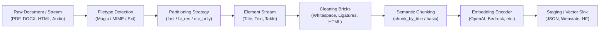

# Architecture

**Analysis Date:** 2026-10-15

## Pattern Overview

**Overall Architecture:** Modular ETL & Document Transformation Pipeline (Pipeline & Composite Pattern).

`unstructured` processes diverse, arbitrary document formats through a standardized six-stage assembly line:
1. **Detection & Ingest:** Inspect file header/stream, determine canonical MIME type and encoding.
2. **Partitioning:** Deconstruct raw document into semantic `Element` components (e.g. `Title`, `NarrativeText`, `Table`, `ListItem`).
3. **Cleaning & Normalization:** Apply deterministic string transformers ("cleaning bricks") to strip artifacts, normalize unicode, fix ligatures, and parse tables.
4. **Context-Aware Chunking:** Group semantic elements into windowed, boundary-aware chunks (`CompositeElement`, `TableChunk`) that respect token limits while preserving section hierarchy for LLM retrieval.
5. **Embedding:** Generate dense vector embeddings across text chunks using cloud or local models.
6. **Staging & Export:** Rehydrate or serialize elements into downstream targets (JSON, Pandas DataFrames, Weaviate objects, HuggingFace datasets).

---

## Conceptual Layers

### 1. Ingestion & Filetype Detection (`unstructured/file_utils`)

- **Purpose**: Identifies file type regardless of whether input is a file path, file descriptor (`IO[bytes]`), or SpooledTemporaryFile.
- **Responsibilities**:
  - Implements multi-tier detection: `content_type` header $\to$ `libmagic` binary inspection $\to$ `filetype` magic numbers $\to$ file extension mapping.
  - Specialized differentiators: `_ZipFileDifferentiator` (distinguishes DOCX, PPTX, XLSX, EPUB from generic ZIPs); `OleFileIO` (distinguishes legacy DOC, PPT, XLS, MSG).
  - Detects character encodings via `charset-normalizer`.
- **Primary Type**: `FileType` enum (in `model.py`), which encapsulates the canonical MIME type, required pip extras, importable packages, and partitioner function names.

### 2. Document Representation Layer (`unstructured/documents`)

- **Purpose**: Canonical in-memory domain model for all processed documents.
- **Key Concepts**:
  - `Element`: Abstract base class representing a coherent unit of content. Contains `text`, lazy string `id`, and an instance of `ElementMetadata`.
  - `ElementMetadata`: Rich metadata container capturing provenance: `filename`, `page_number`, `coordinates`, `text_as_html` (for tables), `languages`, `parent_id`, `data_source`, `chunk_index`, etc.
  - `CoordinatesMetadata`: Spatial bounding boxes tied to a `CoordinateSystem` (e.g. `PixelSpace`, `RelativeCoordinateSystem`), enabling precise document grounding and UI highlighting.
  - `ElementType`: Canonical taxonomy covering `Title`, `NarrativeText`, `ListItem`, `Header`, `Footer`, `Table`, `Image`, `Formula`, `Address`, `CheckBox`, `FormKeysValues`.

### 3. Partitioning Engine (`unstructured/partition`)

- **Purpose**: Deconstructs raw binary/text files into atomic `Element` objects.
- **Core Modules**:
  - `auto.py`: Universal dispatcher. Inspects the file type and dynamically routes execution to the registered partitioner (`partition_pdf`, `partition_docx`, `partition_html`, etc.).
  - `pdf.py` & `pdf_image/`: The most sophisticated engine in the codebase. Supports four execution strategies:
    - `fast`: Direct character/font extraction via `pdfminer.six`. High speed, zero GPU requirement, ideal for digital PDFs.
    - `hi_res`: Computer vision layout detection (YOLOX/LayoutLMv3) to segment bounding boxes into titles, tables, and narrative blocks, followed by OCR extraction.
    - `ocr_only`: Converts pages into bitmap images using `pdf2image` and processes through Tesseract or PaddleOCR.
    - `auto`: Dynamically decides between `fast` and `hi_res` based on embedded text density.
  - Specialized Partitioners: Handlers for 25+ formats (`docx`, `pptx`, `xlsx`, `csv`, `html`, `email`, `msg`, `audio`, `epub`, etc.).

### 4. Cleaning & Enrichment Layer (`unstructured/cleaners`, `unstructured/nlp`)

- **Purpose**: Functional, composable "bricks" that clean and extract entities from text elements.
- **Features**:
  - Whitespace collapse, unicode bullet cleaning, ligature replacement (`fi` $\to$ `fi`), hyphen rejoining across linebreaks.
  - Regex entity extractors (email addresses, phone numbers, IP addresses).
  - Language translation (Helsinki-NLP Marian models).

### 5. Semantic Chunking Layer (`unstructured/chunking`)

- **Purpose**: Groups and segments atomic elements into LLM-ready context windows.
- **Key Strategies**:
  - `basic`: Sequential packing of elements up to a hard character threshold (`max_characters`).
  - `by_title`: Document-structure-aware chunking. Uses `Title` elements as natural section boundaries. Never breaks sentences mid-thought, combines tiny sections (`combine_text_under_n_chars`), and handles multipage sections.
  - Table Isolation & Splitting: Tables can be isolated or split into `TableChunk` objects that automatically repeat table column headers across splits.
  - `ConsolidationStrategy`: Dictates how metadata merges when combining multiple elements (e.g. concatenate URLs, union languages, preserve first page number).

### 6. Embedding & Staging Layer (`unstructured/embed`, `unstructured/staging`)

- **Purpose**: Connects processed elements to downstream vector indexes and annotation environments.
- **Interfaces**:
  - Direct vector injection (`element.embeddings = list[float]`).
  - Schema mapping for vector stores (Weaviate) and annotation platforms (Argilla, Label Studio, Prodigy).
  - Flat tabular export (Pandas DataFrame, CSV).

---

## Data Flow Lifecycle

### Standard Document Execution Flow:

1. **Invocation**: User calls `partition("document.pdf", strategy="auto", chunking_strategy="by_title")`.
2. **Type Detection**: `detect_filetype` inspects the byte header $\to$ identifies `FileType.PDF`.
3. **Partition Dispatch**: `auto.py` invokes `partition_pdf()` with user kwargs.
4. **Layout Analysis & OCR**:
   - In `hi_res` mode, `unstructured-inference` runs layout models over page images.
   - Bounding boxes are categorized (Header, Title, Table, Text).
   - Tables are extracted via Table Transformer into structured HTML (`text_as_html`).
5. **Element Construction**: Concrete instances (`Title`, `Table`, `NarrativeText`) are populated with text, bounding coordinates, and page metadata.
6. **Deterministic ID Mapping**: `assign_and_map_hash_ids` generates repeatable SHA-256 hashes for each element based on text content, sequence number, and page number.
7. **Chunking Interception**: The `@add_chunking_strategy` decorator captures the element list $\to$ invokes `chunk_by_title()` $\to$ merges sub-elements into `CompositeElement`s while preserving section headings.
8. **Output Return**: A clean list of `[CompositeElement, TableChunk, ...]` is returned to the caller.

---

## Error Handling & Fallback Chains

1. **Detection Fallback**:
   - If `libmagic` fails or is not installed $\to$ fallback to Python `filetype` library $\to$ fallback to file extension mapping $\to$ fallback to `FileType.UNK`.
2. **Strategy Fallback**:
   - If a PDF lacks digital text in `fast` mode $\to$ raises warning / switches to OCR.
   - If Table Transformer cannot resolve a complex table $\to$ falls back to standard bounding-box OCR without corrupting the document stream.
3. **Safe HTTP Client**:
   - `safe_http.py` enforces SSRF protection, timeout limits, and size validation when fetching documents over HTTP.
