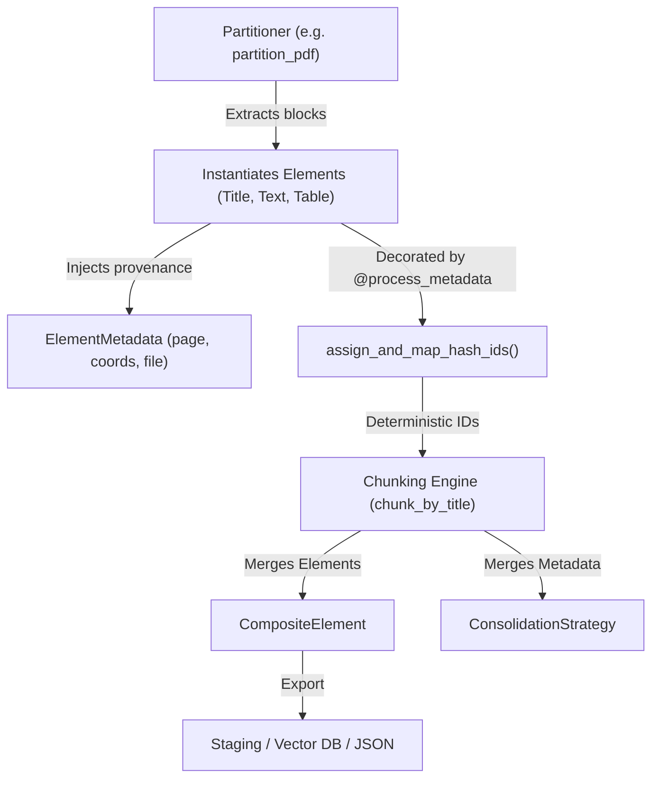

# Feature Blueprint: Document Element Data Model & Spatial Coordinates

**Target Directory:** `unstructured/documents/`
**Primary Files:**
- `unstructured/documents/elements.py`
- `unstructured/documents/coordinates.py`
- `unstructured/documents/ontology.py`

---

## 1. WHY This Feature Was Implemented

### The Problem in Document Processing for LLMs
When raw documents (PDFs, Word docs, web pages) are ingested into language models, developers typically convert them into a single monolithic string or an array of unstructured text fragments. This naive approach suffers from fatal flaws:
1. **Loss of Structural Semantics**: The model cannot tell whether a phrase was a top-level document title, a sub-section header, a bullet item, or a footnote.
2. **Loss of Provenance & Grounding**: When a RAG system answers a query, it cannot cite the exact page number, bounding box coordinates, or original document filename for auditability.
3. **Loss of Hierarchical Relationships**: Parent-child structures (e.g. a list belonging to a specific section header) are discarded.
4. **Non-Deterministic RAG Sync**: Using random UUIDs causes repeated pipeline runs to produce different vector IDs, forcing total re-indexing and breaking caching.

### The Business & Developer Solution
`unstructured` designed a formal object-oriented domain representation:
- Every piece of text is an instance of a typed `Element` subclass (`Title`, `NarrativeText`, `ListItem`, `Table`, etc.).
- Every element holds a strongly-typed `ElementMetadata` container tracking filename, page numbers, coordinates, parent references, and formatting flags.
- Bounding boxes are tracked in spatial coordinate systems (`PixelSpace`, `RelativeCoordinateSystem`), enabling UI highlights on the original document.
- Deterministic SHA-256 hash IDs (`assign_and_map_hash_ids`) ensure that identical content at the same location yields identical IDs across pipeline runs.

---

## 2. WHERE It Is Implemented

### Core Class Hierarchy (`unstructured/documents/elements.py`)

```
Element (Abstract Base Class)
│   ├── text: str
│   ├── id: str (lazy UUID or deterministic hash)
│   ├── metadata: ElementMetadata
│
├── CheckBox (Form checkbox state: checked/unchecked)
└── Text (Base for all textual elements)
    ├── NarrativeText (Multi-sentence body paragraphs)
    │   └── ListItem (Items within ordered/unordered lists)
    ├── Title (Section titles, headers, subheadings)
    ├── Table (Tabular data, raw text + text_as_html)
    │   └── TableChunk (Continuation chunk of a split table)
    ├── CompositeElement (Consolidated chunk produced by chunking)
    ├── Header (Running page headers)
    ├── Footer (Running page footers, footnotes)
    ├── FigureCaption (Captions beneath images or diagrams)
    ├── Image (Image metadata, base64 payload, or OCR text)
    ├── Formula (Mathematical notations / LaTeX)
    ├── Address (Physical postal addresses)
    ├── EmailAddress (Email tokens)
    ├── CodeSnippet (Programming code blocks)
    ├── FormKeysValues (Form key-value pairs)
    └── PageBreak (Explicit document page boundaries)
```

### Key Functions & Code Anchors:
- **`ElementMetadata`** (`elements.py:250-400`): Dataclass encapsulating 40+ metadata properties.
- **`assign_and_map_hash_ids()`** (`elements.py:601-635`): Converts transient UUIDs into deterministic SHA-256 hashes based on `f"{filename}{text}{page_number}{sequence_on_page}"`, while updating all `parent_id` references.
- **`ConsolidationStrategy`** (`elements.py:506-596`): Enum defining field-level merge semantics (`DROP`, `FIRST`, `STRING_CONCATENATE`, `LIST_UNIQUE`, `DICT_LIST_UNIQUE`) when combining multiple elements.
- **`CoordinateSystem` & `PixelSpace`** (`unstructured/documents/coordinates.py:1-120`): Geometric coordinate transformations.

---

## 3. HOW It Is Connected Across the Project



1. **Partitioning Output**: Every partitioner returns a `list[Element]`.
2. **Metadata Processing**: The `@process_metadata()` decorator automatically executes `assign_and_map_hash_ids()`.
3. **Chunking Interception**: When `chunk_by_title()` runs, it aggregates individual `Text` and `Title` elements into `CompositeElement`s, using `ConsolidationStrategy` to determine which metadata fields to keep, concatenate, or drop.
4. **Downstream Serialization**: `elements_to_json()` and `elements_from_json()` serialize the entire hierarchy losslessly.

---

## 4. REUSABLE BLUEPRINT: How to Build This in Your Own Project

If you are building a custom document processing pipeline in Python, TypeScript, or Go, follow this implementation pattern:

### Python Blueprint Pattern:

```python
import hashlib
import uuid
from dataclasses import dataclass, field
from typing import Any, Optional

@dataclass
class ElementMetadata:
    filename: Optional[str] = None
    page_number: Optional[int] = None
    parent_id: Optional[str] = None
    coordinates: Optional[dict[str, Any]] = None
    custom: dict[str, Any] = field(default_factory=dict)

class Element:
    category: str = "Uncategorized"

    def __init__(self, text: str, metadata: Optional[ElementMetadata] = None, element_id: Optional[str] = None):
        self.text = text
        self.metadata = metadata or ElementMetadata()
        self._element_id = element_id

    @property
    def id(self) -> str:
        if self._element_id is None:
            self._element_id = str(uuid.uuid4())
        return self._element_id

    def to_hash_id(self, sequence_on_page: int) -> str:
        """Derive deterministic hash from document spatial coordinates and content."""
        payload = f"{self.metadata.filename}:{self.metadata.page_number}:{sequence_on_page}:{self.text}"
        self._element_id = hashlib.sha256(payload.encode("utf-8")).hexdigest()[:32]
        return self._element_id

    def to_dict(self) -> dict[str, Any]:
        return {
            "type": self.category,
            "element_id": self.id,
            "text": self.text,
            "metadata": self.metadata.__dict__,
        }

class Title(Element):
    category = "Title"

class NarrativeText(Element):
    category = "NarrativeText"

class Table(Element):
    category = "Table"
    def __init__(self, text: str, text_as_html: Optional[str] = None, **kwargs):
        super().__init__(text, **kwargs)
        self.text_as_html = text_as_html
```

### Key Engineering Takeaways:
1. **Never rely on raw strings**: An LLM context pipeline must always pair text with its structural category and metadata container.
2. **Lazy UUID + Deterministic Hash**: Use lazy UUID generation for ad-hoc elements, but provide a hash conversion pass before saving to vector databases.
3. **Preserve HTML for Tables**: Plain text destroys tables; always retain structured HTML (`<table>...</table>`) in metadata alongside flattened text.
