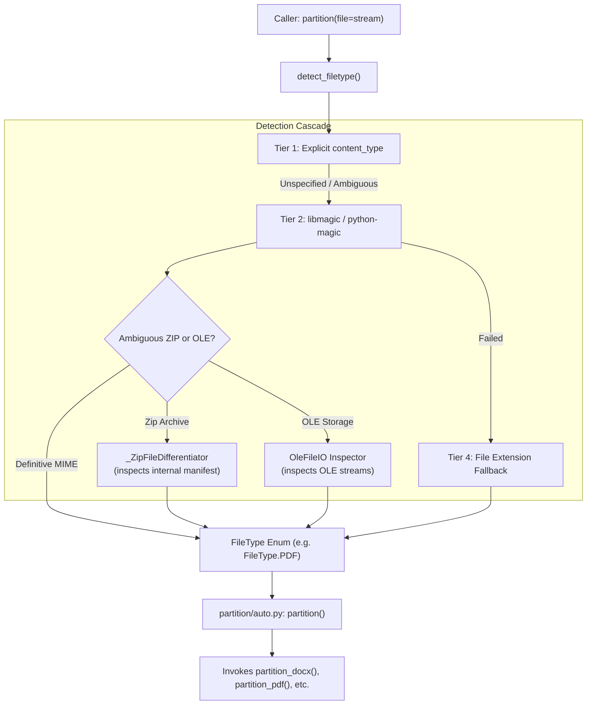

# Feature Blueprint: Smart Multi-Tier Filetype Detection & Format Differentiators

**Target Directory:** `unstructured/file_utils/`
**Primary Files:**
- `unstructured/file_utils/filetype.py`
- `unstructured/file_utils/model.py`

---

## 1. WHY This Feature Was Implemented

### The Problem in Real-World File Ingestion
In production ETL and AI ingestion pipelines, filetype detection is deceptively complex:
1. **Misleading or Missing Extensions**: Files uploaded via webhooks, cloud storage presigned URLs, or APIs often arrive with generic extensions (`.bin`, `.dat`, `.tmp`) or no extension at all.
2. **Compound Zip Disambiguation**: Modern Office documents (`.docx`, `.pptx`, `.xlsx`, `.epub`) are technically PKZIP archives. A standard binary magic-number checker (or libmagic) frequently identifies all of them generically as `application/zip` or `application/octet-stream`.
3. **Compound OLE Binary Disambiguation**: Legacy Microsoft Office files (`.doc`, `.ppt`, `.xls`) and Outlook messages (`.msg`) are binary compound OLE storage files (`application/x-ole-storage`). Pure MIME detection cannot tell an email apart from an Excel spreadsheet.
4. **JSON vs. NDJSON Confusion**: Both formats contain JSON syntax, but NDJSON (newline-delimited JSON) requires streaming line-by-line parsing while JSON requires parsing a single root object or array.

### The Business & Developer Solution
`unstructured` built a multi-tier detection cascade backed by **Format Differentiators**:
- **Tier 1 (Explicit Claim)**: Check caller-asserted MIME type.
- **Tier 2 (Binary Magic Inspection)**: Use `libmagic` (falling back to pure-Python `filetype`).
- **Tier 3 (Compound Inspection)**: If the MIME type is ambiguous (`application/zip` or `application/x-ole-storage`), deep-inspect the container's internal directory table.
- **Tier 4 (Filename Extension)**: Fall back to file extension mapping only if binary sniffing is inconclusive.
- **Tier 5 (Format Disambiguation)**: Run fast byte/character inspection for edge formats (e.g., checking for newlines in JSON).

---

## 2. WHERE It Is Implemented

### Key Components:
- **`FileType` Enum** (`unstructured/file_utils/model.py:45-350`):
  - Encapsulates every supported format with its canonical MIME type, alias MIME types, file extensions, required pip extras, and partitioner function names.
- **`detect_filetype()`** (`unstructured/file_utils/filetype.py:69-150`):
  - Primary entry point accepting `file_path`, `file` stream, `content_type`, and `encoding`.
- **`_ZipFileDifferentiator`** (`unstructured/file_utils/filetype.py:600-750`):
  - Inspects the internal table of contents of zip archives without extracting them to disk.
- **OLE Storage Inspector** (`unstructured/file_utils/filetype.py:750-850`):
  - Uses `olefile.OleFileIO` to inspect root storage streams.
- **JSON / NDJSON Disambiguator** (`unstructured/file_utils/filetype.py:850-950`):
  - Examines the first 1 MiB to detect whether lines contain individual JSON objects.

---

## 3. HOW It Is Connected Across the Project



1. **Auto Partition Dispatch**: `unstructured.partition.auto.partition()` calls `detect_filetype()` as its first operational step.
2. **Metadata Tagging**: The resolved `FileType.mime_type` is written directly into `element.metadata.filetype`.
3. **Dependency Checking**: Before importing the partitioner, the system checks `file_type.importable_package_dependencies`. If missing, it provides a friendly install error.

---

## 4. REUSABLE BLUEPRINT: How to Build This in Your Own Project

Here is a production-ready implementation of a multi-tier file sniffer with Zip and OLE differentiators:

```python
import io
import os
import zipfile
from typing import IO, Optional

class FileTypeDetector:
    @classmethod
    def detect(cls, file: Optional[IO[bytes]] = None, filename: Optional[str] = None) -> str:
        """Accurately identify file type using header bytes, zip inspection, and extensions."""
        header = b""
        if file is not None:
            pos = file.tell()
            header = file.read(4096)
            file.seek(pos)  # Reset stream position!

        # 1. Magic byte checks for direct binary formats
        if header.startswith(b"%PDF"):
            return "application/pdf"
        if header.startswith(b"\x89PNG\r\n\x1a\n"):
            return "image/png"
        if header.startswith(b"\xff\xd8\xff"):
            return "image/jpeg"

        # 2. Compound PKZIP Inspection (DOCX, PPTX, XLSX, EPUB vs raw ZIP)
        if header.startswith(b"PK\x03\x04"):
            if file is not None:
                return cls._differentiate_zip(file)
            elif filename and os.path.exists(filename):
                with open(filename, "rb") as f:
                    return cls._differentiate_zip(f)
            return "application/zip"

        # 3. Compound OLE Inspection (Legacy Office DOC, PPT, XLS, MSG)
        if header.startswith(b"\xd0\xcf\x11\xe0\xa1\xb1\x1a\xe1"):
            return cls._differentiate_ole(file, filename)

        # 4. Fallback to extension mapping
        if filename:
            ext = os.path.splitext(filename)[1].lower()
            extension_map = {
                ".pdf": "application/pdf",
                ".docx": "application/vnd.openxmlformats-officedocument.wordprocessingml.document",
                ".txt": "text/plain",
                ".html": "text/html",
                ".json": "application/json",
                ".csv": "text/csv",
            }
            if ext in extension_map:
                return extension_map[ext]

        return "application/octet-stream"

    @classmethod
    def _differentiate_zip(cls, file: IO[bytes]) -> str:
        """Inspect internal directory names inside PKZIP archive."""
        pos = file.tell()
        try:
            with zipfile.ZipFile(file, "r") as zf:
                namelist = zf.namelist()
                if "word/document.xml" in namelist:
                    return "application/vnd.openxmlformats-officedocument.wordprocessingml.document"
                if "ppt/presentation.xml" in namelist:
                    return "application/vnd.openxmlformats-officedocument.presentationml.presentation"
                if "xl/workbook.xml" in namelist:
                    return "application/vnd.openxmlformats-officedocument.spreadsheetml.sheet"
                if "META-INF/container.xml" in namelist:
                    return "application/epub+zip"
                return "application/zip"
        except Exception:
            return "application/zip"
        finally:
            file.seek(pos)

    @classmethod
    def _differentiate_ole(cls, file: Optional[IO[bytes]], filename: Optional[str]) -> str:
        """Inspect streams in Microsoft OLE compound files."""
        # Check for olefile library if installed
        try:
            import olefile
            ole = olefile.OleFileIO(file or filename)
            if ole.exists("WordDocument"):
                return "application/msword"
            if ole.exists("PowerPoint Document"):
                return "application/vnd.ms-powerpoint"
            if ole.exists("Workbook") or ole.exists("Book"):
                return "application/vnd.ms-excel"
            if ole.exists("__substg1.0_0037001F"):  # Subject property in Outlook MSG
                return "application/vnd.ms-outlook"
        except Exception:
            pass
        return "application/x-ole-storage"
```

### Key Engineering Takeaways:
1. **Always preserve stream position**: When reading header bytes from an `IO[bytes]` stream, always record `pos = file.tell()` and reset `file.seek(pos)` afterwards.
2. **Compound formats require internal manifest checks**: Never assume `PK\x03\x04` is a simple zip file. In enterprise environments, 95% of zip signatures are actually Word or Excel documents.
3. **Graceful degradation**: Combine binary magic inspection, manifest differentiation, and extension fallbacks so the parser never crashes on unexpected streams.
