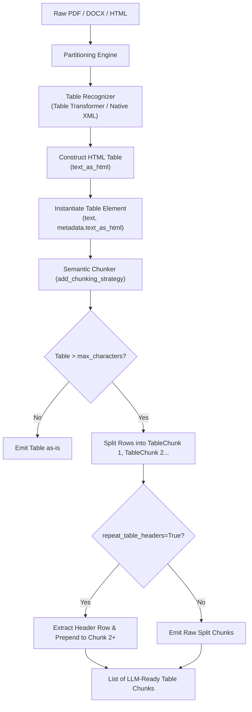

# Feature Blueprint: Table Extraction, HTML Representation & Chunking

**Target Directory:** `unstructured/partition/`, `unstructured/chunking/`
**Primary Files:**
- `unstructured/partition/pdf_image/ocr.py`
- `unstructured/documents/elements.py`
- `unstructured/common/html_table.py`
- `unstructured/chunking/dispatch.py`

---

## 1. WHY This Feature Was Implemented

### The Problem with Tables in LLM / RAG Systems
Tables represent the highest-density information in business documents (financial reports, pricing sheets, technical specifications, medical labs). Yet they are the number one failure point for RAG:
1. **Flattening Destroys Meaning**:
   - When a table is extracted as plain text, rows and columns are flattened:
     `Revenue Q1 Q2 Expenses Q1 Q2 $10M $12M $8M $9M`
   - An LLM reading this cannot reliably answer "What was Q2 revenue?" because spatial alignment is lost.
2. **Context Loss on Chunk Truncation**:
   - In real documents, tables can span dozens or hundreds of rows.
   - When a chunker cuts a table across token limits, chunk 2 starts at row 45:
     `| 452 | John Doe | 98.4 | ACTIVE |`
   - Without the column headers (`ID`, `Customer Name`, `Score`, `Status`), the chunk is completely meaningless noise to an LLM or embedding model.

### The Business & Developer Solution
`unstructured` introduced a dual-layer table representation:
1. **HTML & Structured Representation**:
   - Every `Table` element carries both a plain-text fallback AND a fully-formed HTML string in `element.metadata.text_as_html` (`<table><tr><th>...</th></tr>...</table>`). LLMs excel at parsing HTML table semantics.
2. **Table Header Propagation during Chunking**:
   - When a table exceeds `max_characters`, the chunker splits it into `TableChunk` elements.
   - When `repeat_table_headers=True`, the chunker extracts the table's header row and automatically injects it into every continuation chunk.

---

## 2. WHERE It Is Implemented

### Key Components:
- **`Table` and `TableChunk` Elements** (`unstructured/documents/elements.py:1018-1028`):
  - Subclasses of `Text` with `metadata.text_as_html` and `metadata.table_as_cells`.
- **Table Structure Inference** (`unstructured/partition/pdf_image/ocr.py:36-120`):
  - Uses Table Transformer models to detect cell bounding boxes, spanning cells, and structural rows/columns.
- **HTML Table Cell Normalization** (`unstructured/common/html_table.py:1-150`):
  - Cleans cell text, handles empty cells, and outputs standard HTML tables.
- **Table Chunking & Header Repetition** (`unstructured/chunking/dispatch.py:20-85`):
  - `repeat_table_headers`: Extracts `<thead>` or the first `<tr>` elements and prepends them to subsequent split chunks.

---

## 3. HOW It Is Connected Across the Project



---

## 4. REUSABLE BLUEPRINT: How to Build This in Your Own Project

Here is a practical Python implementation for preserving table headers across chunk boundaries:

```python
from bs4 import BeautifulSoup
from typing import List

class TableChunker:
    @staticmethod
    def chunk_html_table(html_table: str, max_rows_per_chunk: int = 15, repeat_headers: bool = True) -> List[str]:
        """Splits an oversized HTML table into multiple table chunks while preserving column headers."""
        soup = BeautifulSoup(html_table, "html.parser")
        table = soup.find("table")
        if not table:
            return [html_table]

        # Extract headers (from <thead> or first <tr>)
        headers_html = ""
        thead = table.find("thead")
        if thead:
            headers_html = str(thead)
            rows = table.find("tbody").find_all("tr") if table.find("tbody") else table.find_all("tr")[1:]
        else:
            all_rows = table.find_all("tr")
            if not all_rows:
                return [html_table]
            headers_html = f"<thead>{str(all_rows[0])}</thead>"
            rows = all_rows[1:]

        if len(rows) <= max_rows_per_chunk:
            return [html_table]

        chunks = []
        for i in range(0, len(rows), max_rows_per_chunk):
            chunk_rows = rows[i:i + max_rows_per_chunk]
            body_content = "".join(str(r) for r in chunk_rows)
            
            # If repeat_headers is true, always prepend the header table structure
            if repeat_headers or i == 0:
                chunk_table = f"<table>{headers_html}<tbody>{body_content}</tbody></table>"
            else:
                chunk_table = f"<table><tbody>{body_content}</tbody></table>"
                
            chunks.append(chunk_table)

        return chunks

# Example Usage:
table_html = """
<table>
  <tr><th>Quarter</th><th>Region</th><th>Revenue</th><th>Growth</th></tr>
  <tr><td>Q1</td><td>North America</td><td>$10M</td><td>12%</td></tr>
  <tr><td>Q1</td><td>EMEA</td><td>$8M</td><td>9%</td></tr>
  <tr><td>Q2</td><td>North America</td><td>$12M</td><td>15%</td></tr>
  <tr><td>Q2</td><td>EMEA</td><td>$9M</td><td>10%</td></tr>
</table>
"""

chunker = TableChunker()
chunks = chunker.chunk_html_table(table_html, max_rows_per_chunk=2, repeat_headers=True)
for idx, chunk in enumerate(chunks):
    print(f"--- Chunk {idx+1} ---")
    print(chunk)
```

### Key Engineering Takeaways:
1. **HTML is the best format for LLM tables**: Markdown tables break with multi-line or complex cells. HTML tables preserve spans (`colspan`, `rowspan`) cleanly.
2. **Never split tables without repeating headers**: Continuation table chunks without headers lose their semantic anchors in vector embedding space.
3. **Dual storage**: Store flattened text for simple lexical BM25 search, but always pass `text_as_html` in metadata for dense embedding and LLM prompt generation.
