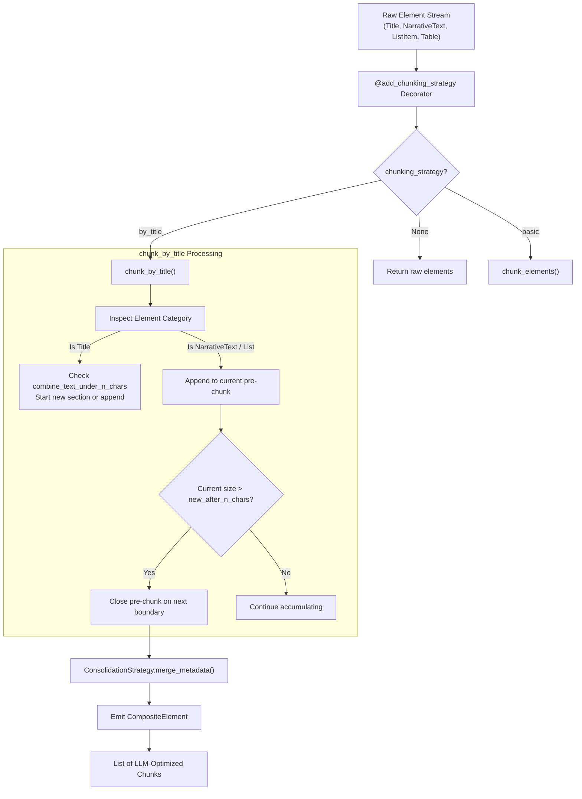

# Feature Blueprint: Context-Aware Semantic Chunking for RAG

**Target Directory:** `unstructured/chunking/`
**Primary Files:**
- `unstructured/chunking/title.py`
- `unstructured/chunking/basic.py`
- `unstructured/chunking/dispatch.py`
- `unstructured/documents/elements.py`

---

## 1. WHY This Feature Was Implemented

### The Problem with Naive Chunking
Standard text splitters (like recursive character text splitters with fixed token sizes) are the root cause of poor RAG accuracy:
1. **Sentence Mutilation**: Splitting strictly on character or token counts often severs sentences in half:
   - Chunk 1 ends: *"The quarterly loss was attributed to"*
   - Chunk 2 begins: *"a 40% decline in foreign exchange rates."*
2. **Title Separation (Loss of Contextual Anchors)**:
   - In naive splitting, a section header like `"Warranty and Liability Exclusions"` ends up at the tail end of Chunk 1, while the actual exclusion clauses land in Chunk 2. Chunk 2 now has zero topical context in vector space.
3. **Cross-Topic Pollution**:
   - Fixed-size windows routinely blend the conclusion of Topic A with the introduction of Topic B into a single chunk, degrading semantic embedding sharpness.
4. **Tiny Fragment Inefficiency**:
   - A document with three short subtitles in a row produces tiny, useless 15-character chunks unless an intelligent grouping heuristic is applied.

### The Business & Developer Solution
`unstructured` developed **`chunk_by_title`**:
- **Semantic Boundary Awareness**: Uses detected `Title` elements as structural boundary markers.
- **Dual Thresholds (`max_characters` and `new_after_n_chars`)**:
  - `max_characters`: Hard ceiling. No chunk ever exceeds this size.
  - `new_after_n_chars`: Soft ceiling. Once a chunk exceeds this threshold, the chunker waits for the next natural semantic boundary (such as a paragraph or title) to cleanly close the chunk.
- **Section Aggregation (`combine_text_under_n_chars`)**: Combines consecutive small sections to avoid creating low-entropy fragments.
- **Metadata Consolidation**: Deterministically merges page numbers, languages, and filenames into the resulting `CompositeElement`.

---

## 2. WHERE It Is Implemented

### Key Components:
- **`chunk_by_title()`** (`unstructured/chunking/title.py:1-250`):
  - Primary algorithm implementing structure-aware section grouping.
- **`chunk_elements()`** (`unstructured/chunking/basic.py:1-150`):
  - Fallback sequential packing algorithm.
- **`@add_chunking_strategy` Decorator** (`unstructured/chunking/dispatch.py:44-100`):
  - Wraps any partitioner call (`partition_pdf`, `partition_html`), inspecting `chunking_strategy="by_title"` and executing chunking transparently.
- **`ConsolidationStrategy`** (`unstructured/documents/elements.py:506-596`):
  - Explicit enum dictating how metadata fields are unified when multiple elements merge into a single `CompositeElement`.

---

## 3. HOW It Is Connected Across the Project



---

## 4. REUSABLE BLUEPRINT: How to Build This in Your Own Project

Here is a clean Python implementation of title-aware semantic chunking with soft and hard limits:

```python
from dataclasses import dataclass, field
from typing import List, Optional

@dataclass
class DocumentElement:
    category: str  # "Title", "NarrativeText", "ListItem"
    text: str
    page_number: int

@dataclass
class SemanticChunk:
    text: str
    primary_category: str
    page_numbers: List[int] = field(default_factory=list)
    constituent_count: int = 0

def chunk_by_title(
    elements: List[DocumentElement],
    max_characters: int = 1000,
    new_after_n_chars: int = 700,
    combine_text_under_n_chars: int = 250,
) -> List[SemanticChunk]:
    """Groups document elements into coherent chunks respecting title boundaries and size limits."""
    chunks: List[SemanticChunk] = []
    
    current_texts: List[str] = []
    current_pages: set[int] = set()
    current_len: int = 0
    current_category: str = "NarrativeText"

    def flush_chunk():
        nonlocal current_texts, current_pages, current_len, current_category
        if current_texts:
            chunks.append(SemanticChunk(
                text="\n\n".join(current_texts),
                primary_category=current_category,
                page_numbers=sorted(list(current_pages)),
                constituent_count=len(current_texts)
            ))
            current_texts = []
            current_pages = set()
            current_len = 0
            current_category = "NarrativeText"

    for el in elements:
        el_len = len(el.text)
        is_title = (el.category == "Title")

        # Decision 1: If current chunk has exceeded soft threshold (new_after_n_chars)
        # and we encounter a title, flush immediately to start a clean new topic chunk.
        if is_title and current_len >= combine_text_under_n_chars:
            flush_chunk()

        # Decision 2: If appending this element would violate hard ceiling (max_characters),
        # flush the current chunk first.
        if (current_len + el_len + 2) > max_characters and current_texts:
            flush_chunk()

        # Append element
        if not current_texts and is_title:
            current_category = "Title"
            
        current_texts.append(el.text)
        current_pages.add(el.page_number)
        current_len += el_len + 2

        # Decision 3: If soft threshold reached and current element was a full paragraph,
        # prepare to flush if next element is distinct.
        if current_len >= new_after_n_chars and not is_title:
            flush_chunk()

    flush_chunk()
    return chunks

# Example Demonstration:
sample_elements = [
    DocumentElement("Title", "1. Introduction to Quantum Computing", 1),
    DocumentElement("NarrativeText", "Quantum computers leverage superposition and entanglement to perform complex operations.", 1),
    DocumentElement("NarrativeText", "Unlike classical bits which are 0 or 1, qubits represent linear combinations of both states.", 1),
    DocumentElement("Title", "2. Physical Implementations", 2),
    DocumentElement("NarrativeText", "Superconducting loops, trapped ions, and topological qubits represent the primary modern hardware approaches.", 2),
]

chunks = chunk_by_title(sample_elements, max_characters=500, new_after_n_chars=250)
for idx, c in enumerate(chunks):
    print(f"\n--- Chunk {idx+1} (Pages: {c.page_numbers}) ---")
    print(c.text)
```

### Key Engineering Takeaways:
1. **Never split on fixed character counts alone**: Always use document layout semantics (Titles vs Paragraphs) to determine cut points.
2. **Soft vs. Hard limits**: Soft limits (`new_after_n_chars`) allow the chunker to wait for natural paragraph breaks, while hard limits (`max_characters`) guarantee token safety.
3. **Consolidate metadata**: When combining multiple elements into a chunk, union page numbers and preserve document origins for auditability.
