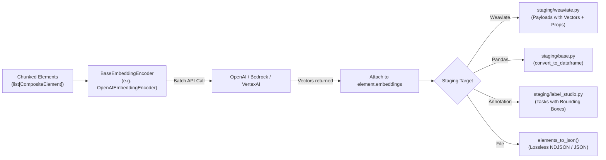

# Feature Blueprint: Vector Embedding Injection & Multi-Sink Staging

**Target Directory:** `unstructured/embed/`, `unstructured/staging/`
**Primary Files:**
- `unstructured/embed/interfaces.py`
- `unstructured/embed/openai.py`
- `unstructured/staging/base.py`
- `unstructured/staging/weaviate.py`
- `unstructured/staging/argilla.py`

---

## 1. WHY This Feature Was Implemented

### The Problem in RAG & Data Infrastructure Integration
A document ETL pipeline is incomplete if it stops at string extraction:
1. **Pipeline Disconnection**: Developers often process documents with one tool, save JSON files, write custom Python scripts to invoke an embedding API (like OpenAI or Bedrock), and write another custom script to format payloads for their vector database (like Weaviate).
2. **Metadata Drift**: In custom handoffs, coordinates, page numbers, and table HTML are frequently lost or mismatched with their embedding vectors.
3. **Decoupled Evaluation**: Without a unified staging layer, exporting documents into annotation tools (Label Studio, Argilla, Prodigy) to check OCR/chunk quality requires writing custom dataset converters.

### The Business & Developer Solution
`unstructured` unified vector embedding and downstream export directly within the document object lifecycle:
- **Direct Vector Injection**: `BaseEmbeddingEncoder` embeds chunks in batches and assigns the resulting float vector directly to the `element.embeddings` attribute.
- **Unified Staging Adapters**: Built-in formatters convert `list[Element]` into:
  - Vector database schemas (Weaviate objects with vector and metadata properties).
  - Data science tables (`convert_to_dataframe()` for Pandas).
  - Annotation platforms (Argilla, Label Studio, Prodigy).
  - Lossless streaming formats (NDJSON, compressed base64).

---

## 2. WHERE It Is Implemented

### Key Components:
- **`BaseEmbeddingEncoder`** (`unstructured/embed/interfaces.py:1-40`):
  - Abstract base defining `initialize()`, `embed_documents()`, `embed_query()`, `num_of_dimensions`, and `is_unit_vector`.
- **Embedding Implementations** (`unstructured/embed/`):
  - `openai.py`: OpenAI API client supporting `text-embedding-3-small`, `text-embedding-3-large`.
  - `bedrock.py`: AWS Bedrock client for Amazon Titan and Cohere embeddings.
  - `vertexai.py`: Google Cloud Vertex AI client.
  - `huggingface.py`: Local PyTorch sentence-transformers.
  - `voyageai.py`: Voyage AI specialized embedding models.
- **Staging Adapters** (`unstructured/staging/`):
  - `weaviate.py`: Formats elements for Weaviate schema collections.
  - `base.py:convert_to_dataframe()`: Flattens element hierarchy into Pandas DataFrame.
  - `argilla.py` & `label_studio.py`: Annotation task exports.

---

## 3. HOW It Is Connected Across the Project



---

## 4. REUSABLE BLUEPRINT: How to Build This in Your Own Project

Here is a clean Python design pattern demonstrating direct vector embedding attachment and vector database staging:

```python
from abc import ABC, abstractmethod
from dataclasses import dataclass
from typing import Any, Dict, List, Optional

@dataclass
class Chunk:
    text: str
    element_id: str
    metadata: Dict[str, Any]
    embeddings: Optional[List[float]] = None

class BaseEmbeddingProvider(ABC):
    @abstractmethod
    def embed_chunks(self, chunks: List[Chunk]) -> List[Chunk]:
        """Generate vector embeddings and mutate chunk.embeddings in-place."""
        pass

class MockOpenAIEmbeddings(BaseEmbeddingProvider):
    def __init__(self, model_name: str = "text-embedding-3-small"):
        self.model_name = model_name

    def embed_chunks(self, chunks: List[Chunk]) -> List[Chunk]:
        # In real code: call client.embeddings.create(input=[c.text for c in chunks])
        for idx, chunk in enumerate(chunks):
            # Synthetic 4-dimensional vector for illustration
            chunk.embeddings = [0.12 * (idx + 1), -0.05, 0.88, 0.42]
        return chunks

class StagingAdapter:
    @staticmethod
    def to_weaviate_objects(chunks: List[Chunk], class_name: str = "DocumentChunk") -> List[Dict[str, Any]]:
        """Converts embedded chunks directly into Weaviate batch insertion objects."""
        weaviate_objects = []
        for chunk in chunks:
            weaviate_objects.append({
                "class": class_name,
                "id": chunk.element_id,
                "properties": {
                    "text": chunk.text,
                    "filename": chunk.metadata.get("filename"),
                    "page_number": chunk.metadata.get("page_number"),
                    "category": chunk.metadata.get("category"),
                },
                "vector": chunk.embeddings
            })
        return weaviate_objects

    @staticmethod
    def to_flat_dicts(chunks: List[Chunk]) -> List[Dict[str, Any]]:
        """Converts chunks to flat records suitable for Pandas DataFrame loading."""
        records = []
        for c in chunks:
            rec = {
                "id": c.element_id,
                "text": c.text,
                "has_vector": c.embeddings is not None,
                **c.metadata
            }
            records.append(rec)
        return records

# Example Usage:
chunks = [
    Chunk("Overview of Artificial Intelligence.", "id-001", {"filename": "ai.pdf", "page_number": 1, "category": "Title"}),
    Chunk("Deep learning neural networks require substantial GPU compute.", "id-002", {"filename": "ai.pdf", "page_number": 1, "category": "NarrativeText"}),
]

embedder = MockOpenAIEmbeddings()
embedded_chunks = embedder.embed_chunks(chunks)

weaviate_payload = StagingAdapter.to_weaviate_objects(embedded_chunks)
print("Weaviate Payload Example:")
print(weaviate_payload[0])
```

### Key Engineering Takeaways:
1. **Attach vectors to the entity**: Keep vectors coupled with document metadata on the in-memory object to prevent coordinate/metadata misalignment.
2. **Decouple the sink**: The parser should not care whether the ultimate destination is Weaviate, Pinecone, or a local Pandas DataFrame. Provide dedicated staging adapters.
3. **Batch embedding calls**: Always batch text elements when invoking remote embedding APIs (e.g. 64 or 128 elements per HTTP request) to optimize throughput.
